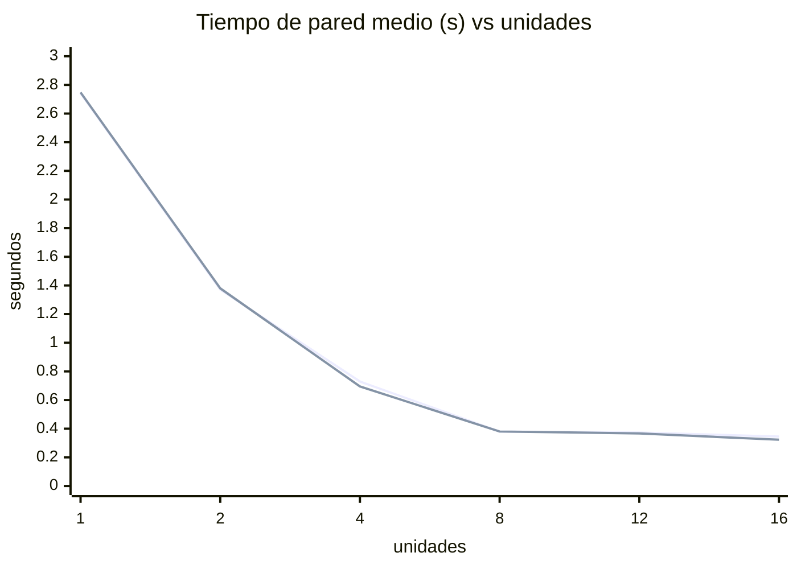

# Laboratorio de Sistemas Operativos: Procesos e Hilos
## Concurrencia, Paralelismo y Planificación de CPU en Linux

**Informe experimental completo**

---

## 1. Portada y datos del laboratorio

| Dato | Valor |
|---|---|
| Título | Procesos e Hilos: Concurrencia, Paralelismo y Planificación de CPU |
| Asignatura | Sistemas Operativos |
| Tipo de entrega | Informe experimental reproducible |
| Equipo anfitrión | `nightmare` (CachyOS Linux, kernel 7.2.9-2-cachyos-bore) |
| Arquitectura | x86_64 (AMD Ryzen 5 5500U, Zen 2) |
| Compilador | GCC 16.2.1 20260810 (también disponible clang 23.1.1) |
| Lenguaje | C (ISO C11) y scripts de análisis en Python 3.14 |
| Fecha de ejecución | 2026-10-13, 16:16–16:22 (America/Bogota, −05:00) |
| Directorio de trabajo | `/home/chaos/Projects/universidad/os/taller` |
| Alcance | **Exclusivamente Linux** |
| Evidencia | Salidas de terminal, archivos CSV y de log (no se dispone de capturas gráficas de escritorio) |

> **Nota metodológica de honestidad.** Todos los valores de este informe fueron **medidos** en el equipo descrito. Cuando un valor no pudo medirse se marca explícitamente como `No medido`.

---

## 2. Resumen ejecutivo

Se caracterizó un equipo con **1 socket, 6 núcleos físicos, SMT de 2 hilos por núcleo ⇒ 12 procesadores lógicos** (AMD Ryzen 5 5500U). Se implementó una carga CPU-bound determinista (generador xorshift64 con dependencia de datos) y se construyeron versiones **secuencial, con hilos POSIX y con procesos (`fork`)** para Linux.

Se ejecutó un experimento de escalado con **800 000 000 iteraciones de trabajo total**, repartidas entre las unidades, con **3 repeticiones por configuración** (1, 2, 4, 8, 12 y 16 hilos/procesos).

Resultados principales **medidos**:

- 1 unidad (secuencial): **2.738 s** de media; utilización ~**99 %**.
- 2 hilos: **1.372 s** (speedup **1.997**, eficiencia **99.8 %**).
- 4 hilos: **0.729 s** (speedup **3.75**, eficiencia **93.9 %**).
- 8 hilos: **0.380 s** (speedup **7.21**, eficiencia **90.1 %**).
- 12/16 hilos: **0.373 / 0.345 s** (speedup **7.3 / 7.9**): el escalado **se satura**.
- Proceso vs hilo: prácticamente iguales en esta carga pura de cómputo (4 procesos = **0.695 s** vs 4 hilos = 0.729 s), con costos de creación/comunicación distintos.
- **Afinidad a 1 solo procesador lógico con 4 hilos ⇒ 2.762 s** (idéntico al secuencial): hubo **concurrencia sin paralelismo**.
- La **migración de hilos** se observó directamente: con 24 hilos (>12 LP) cada hilo visitó entre **1 y 5 CPUs** con hasta **15 migraciones**; fijados con `taskset -c 0`, todos permanecieron en la CPU 0 (**0 migraciones**).
- Con **`perf`** (§13.4): todas las configuraciones ejecutan **el mismo número de instrucciones (~1.04×10¹⁰)**; el **IPC cae de ~1.85 (1 hilo) a ~1.70 (8–16 hilos)** por contención SMT; y los **cambios de contexto** pasan de ~20–50 (hilos ≤ núcleos) a **1253 (12 hilos)** y **2108 (4 hilos fijados a 1 LP)**, huella directa del *time-slicing*.

La **principal limitación** fue que las mediciones se hicieron en un **escritorio con carga de fondo** (compositor COSMIC, navegador Zen, `mpvpaper`, el propio agente `opencode`, y uso de swap). Esto reduce la CPU efectivamente disponible del proceso a ~10 de 12 LP en cargas largas y explica la saturación del speedup alrededor de 8 unidades y la varianza observada.

---

## 3. Introducción y planteamiento del problema

Un programa se convierte en uno o más **procesos**; un proceso puede contener uno o más **hilos**. En un equipo con varios **procesadores lógicos**, el **planificador (scheduler)** decide qué hilo se ejecuta en qué CPU y cuándo. La pregunta central del laboratorio es: *¿cómo se relaciona la estructura del software (procesos/hilos) con la arquitectura física (núcleos, SMT) y con la planificación del sistema operativo, y cómo se refleja todo eso en el tiempo de pared y la utilización de CPU?*

Se estudia la cadena:

`Programa → Proceso → Hilos → Scheduler → Procesadores lógicos → Núcleos físicos → Ejecución`

El laboratorio exige distinguir con rigor **concurrencia** (varias tareas en progreso, no necesariamente a la vez) de **paralelismo** (varias tareas ejecutándose físicamente al mismo tiempo), **tiempo de pared** (reloj) de **tiempo de CPU** (suma del tiempo que las CPUs dedicaron al proceso), y **proceso** de **hilo** (espacios de memoria e identidades distintos).

---

## 4. Objetivos

1. Caracterizar el hardware (sockets, núcleos físicos, hilos por núcleo, procesadores lógicos, NUMA).
2. Implementar y compilar cargas CPU-bound secuenciales, con hilos y con procesos.
3. Medir tiempo de pared, tiempo de CPU y utilización para 1–16 unidades.
4. Analizar el efecto de la afinidad de CPU y demostrar la migración de hilos.
5. Comparar proceso frente a hilo (memoria, comunicación, creación, aislamiento, sincronización).
6. Aplicar medición estadística (promedio, rango, desviación estándar) y calcular speedup y eficiencia.
7. Explicar los resultados en términos de arquitectura y planificación, sin conclusiones genéricas.

---

## 5. Marco conceptual

- **CPU física / socket**: la unidad que se inserta en un zócalo. Aquí hay 1 socket. `lscpu` lo reporta como `Socket(s): 1`.
- **Núcleo físico (core)**: unidad de ejecución independiente dentro del socket, con sus propias unidades de ejecución y cachés L1/L2. Aquí hay 6.
- **SMT (Simultaneous Multithreading / “hilos por núcleo”)**: un núcleo físico mantiene dos contextos de registro y comparte sus recursos de ejecución. Cada contexto aparece como un **procesador lógico**. Aquí 2 hilos/núcleo ⇒ 6×2 = 12.
- **Procesador lógico (LP)**: lo que el SO planifica individualmente; “CPU” en `lscpu -e`. No equivale a un núcleo físico: dos LP comparten un núcleo.
- **Proceso**: instancia con su propio espacio de direcciones, descriptores, PID. Aislado. Se crea con `fork`.
- **Hilo**: flujo de ejecución dentro de un proceso; comparte el espacio de direcciones y archivos con sus pares; tiene su propio TID, pila y contexto de registros. Se crea con `pthread_create` (en Linux, internamente `clone`).
- **Concurrencia**: varias tareas progresan en el tiempo; puede darse **en un solo LP** por multiplexación temporal (intercalado).
- **Paralelismo**: varias tareas ejecutan **al mismo tiempo** en LPs distintos. Requiere ≥2 LP disponibles.
- **Tiempo de pared (wall)**: tiempo de reloj transcurrido. **Tiempo de CPU**: suma del tiempo de CPU consumido por **todos** los hilos del proceso. Si un proceso usa N CPUs a plena carga, `tiempo_cpu ≈ N × tiempo_pared`; por eso la **utilización** se expresa como `tiempo_cpu / tiempo_pared × 100 %` y puede superar 100 %.
- **Scheduler**: el planificador de Linux (CFS/EEVDF, con balanceo de carga) asigna LPs, aplica **afinidad** (`cpus_allowed`) y puede **migrar** hilos. En CachyOS el kernel es `bore` (variante de scheduler orientada a interactividad), sobre la base CFS/EEVDF.
- **Speedup** `S(n) = T1/Tn`; **Eficiencia** `E(n) = S(n)/n × 100 %`.

---

## 6. Caracterización del equipo y del entorno

### 6.1 Comandos de identificación

```bash
uname -a
lscpu
lscpu -e
lscpu -e=CORE,SOCKET,NODE,CPU,ONLINE
nproc
cat /etc/os-release
gcc --version
numactl --hardware
```

### 6.2 Salidas (evidencia textual)

```
$ uname -a
Linux nightmare 7.2.9-2-cachyos-bore #1 SMP PREEMPT_DYNAMIC Fri, 09 Oct 2026 12:11:42 +0000 x86_64 GNU/Linux

$ nproc
12

$ cat /etc/os-release
NAME="CachyOS Linux"
PRETTY_NAME="CachyOS"
ID=cachyos
ID_LIKE=arch
BUILD_ID=rolling

$ gcc --version
gcc (GCC) 16.2.1 20260810
Copyright (C) 2026 Free Software Foundation, Inc.
```

Extracto de `lscpu`:

```
Architecture:            x86_64
CPU(s):                  12
On-line CPU(s) list:     0-11
Vendor ID:               AuthenticAMD
Model name:              AMD Ryzen 5 5500U with Radeon Graphics
CPU family:              23
Model:                   104
Thread(s) per core:      2
Core(s) per socket:      6
Socket(s):               1
NUMA node(s):            1
NUMA node0 CPU(s):       0-11
L1d cache:               192 KiB (6 instances)   -> 32 KiB por núcleo
L1i cache:               192 KiB (6 instances)   -> 32 KiB por núcleo
L2 cache:                3 MiB (6 instances)      -> 512 KiB por núcleo
L3 cache:                8 MiB (2 instances)      -> 2 CCX de 4 MiB
CPU max MHz:             2100,0000   (nota: sin incluir boost)
CPU min MHz:             413,6370
```

Topología lógica (`lscpu -e`), donde se aprecia que los LP pares comparten `CORE` y caché L3:

```
CPU NODE SOCKET CORE L1d:L1i:L2:L3 ONLINE    MAXMHZ   MHZ
  0    0      0    0 0:0:0:0          yes 2100,0000 2071,04
  1    0      0    0 0:0:0:0          yes 2100,0000 2068,74
  2    0      0    1 1:1:1:0          yes 2100,0000 2064,83
  3    0      0    1 1:1:1:0          yes 2100,0000 2071,25
  4    0      0    2 2:2:2:0          yes 2100,0000 2071,28
  5    0      0    2 2:2:2:0          yes 2100,0000 2071,17
  6    0      0    3 4:4:4:1          yes 2100,0000 2071,27
  7    0      0    3 4:4:4:1          yes 2100,0000 413,64
  8    0      0    4 5:5:5:1          yes 2100,0000 1378,43
  9    0      0    4 5:5:5:1          yes 2100,0000 2070,99
 10    0      0    5 6:6:6:1          yes 2100,0000 2070,72
 11    0      0    5 6:6:6:1          yes 2100,0000 2071,25
```

Relevante: los pares de LP que comparten núcleo son **(0,1), (2,3), (4,5), (6,7), (8,9), (10,11)**; y los LP 0–5 comparten la instancia L3 `0` y los LP 6–11 la instancia L3 `1` (dos chiplets/CCX).

`numactl --hardware`:

```
available: 1 nodes (0)
node 0 cpus: 0 1 2 3 4 5 6 7 8 9 10 11
node 0 size: 7245 MB
node 0 free: 711 MB
node distances:
node   0
  0:  10
```

Estado de energía/frecuencia (relevante para la validez):

```
$ cat /sys/devices/system/cpu/cpu0/cpufreq/scaling_governor
powersave
$ cat /sys/devices/system/cpu/cpufreq/boost
1
$ cat /sys/devices/system/cpu/smt/active
1
```

### 6.3 Tabla de caracterización del equipo

| Dato | Valor medido | Interpretación |
|---|---|---|
| Sockets / CPUs físicas | **1** | Un solo zócalo; un único chip AMD Ryzen 5 5500U. |
| Núcleos por socket | **6** | 6 núcleos físicos (Zen 2), cada uno con L1/L2 propios. |
| Hilos por núcleo | **2** | SMT activo (`smt/active = 1`): 2 contextos por núcleo. |
| Procesadores lógicos | **12** | 6 × 2 = 12 LP online (0–11). |
| Modelo de CPU | **AMD Ryzen 5 5500U with Radeon Graphics** | APU de portátil, familia 23 (Zen 2), modelo 104. |
| NUMA | **1 nodo (node0, CPUs 0–11, 7 245 MB)** | No hay NUMA real: el acceso a memoria es uniforme (`distance 10`). |
| Cachés | L1 32 KiB×6, L2 512 KiB×6, L3 4 MiB×2 | Dos CCX con 4 MiB de L3 cada uno. |
| Governor / boost | **powersave / boost=1** | Frecuencia dinámica; afecta la reproducibilidad (ver Limitaciones). |

**Interpretación (6 líneas).** El equipo es un APU de un solo socket con 6 núcleos físicos y SMT de 2 vías, lo que expone **12 procesadores lógicos** al planificador. Como solo hay 6 núcleos reales, el paralelismo “duro” máximo es 6; los 12 LP permiten paralelismo lógico pero dos hilos que comparten núcleo compiten por las mismas unidades de ejecución (SMT ≈ +25–30 % global, no ×2). Existe un único nodo NUMA, por lo que no hay penalización por acceso remoto a memoria. La caché L3 está **particionada en dos CCX de 4 MiB**, de modo que dos hilos en chiplets distintos no comparten L3: es un factor que se vuelve relevante si la carga usara mucha memoria (la nuestra es casi puramente de registros). El governor `powersave` con `boost` habilitado implica frecuencia dinámica, principal fuente de variación.

---

## 7. Diseño experimental y variables controladas

- **Carga CPU-bound determinista.** Bucle `xorshift64` con dependencia encadenada (`loop-carried`) y acumulación de una constante por iteración. El resultado se publica en un sumidero `volatile` para impedir que el compilador elimine el bucle. Se evita la vectorización automática por la dependencia de datos.
- **Trabajo total fijo.** Todas las configuraciones ejecutan **800 000 000 iteraciones en total**, repartidas entre las unidades con `work_for()` (`cociente` a todas y `+1` a las primeras `resto`). Así, la suma de iteraciones es **exactamente** el total, independientemente del número de unidades.
- **Código común.** Secuencial, hilos y procesos usan la **misma** función `spin_work()` (mismo compilador y opciones `-O2`).
- **Variables independientes**: número de unidades (1, 2, 4, 8, 12, 16) y mecanismo (hilo/proceso), además de la afinidad.
- **Variables dependientes**: tiempo de pared, tiempo de CPU, utilización, checksum.
- **Variables controladas**: mismo equipo, mismo ejecutable por variante, mismo directorio, mismo tamaño de trabajo, mismo compilador (`gcc -O2 -std=c11 -pthread`), 3 repeticiones por configuración.
- **No controladas (amenazas)**: carga de fondo del escritorio, frecuencia dinámica (turbo/powersave), migración de hilos, estado térmico, memoria en swap.

**Validación de trabajo comparable.** Como prueba de que hilo y proceso con el mismo número de unidades hacen el **mismo** trabajo, sus checksums coinciden exactamente:

| Unidades | Checksum (hilos) | Checksum (procesos) | ¿Iguales? |
|---|---|---|---|
| 1 | 5016696464481751843 | 5016696464481751843 | Sí |
| 2 | 7442341834515209853 | 7442341834515209853 | Sí |
| 4 | 4314293330488784900 | 4314293330488784900 | Sí |
| 8 | 14461307954345427537 | 14461307954345427537 | Sí |
| 12 | 18414268772342709515 | 18414268772342709515 | Sí |
| 16 | 16404114876640175641 | 16404114876640175641 | Sí |

Entre distinto número de unidades los checksums difieren (cambia el reparto y la semilla de cada unidad), pero el **total de iteraciones es el mismo por construcción**.

---

## 8. Código fuente y explicación de la implementación

Archivos en `src/` (código completo en el Anexo A):

| Archivo | Descripción |
|---|---|
| `work.h` | Carga común, temporización, reparto de trabajo, reporte. |
| `secuencial.c` | Versión secuencial (1 unidad). |
| `hilos_pthread.c` | Hilos POSIX (`pthread_create` / `pthread_join`). |
| `procesos_fork.c` | Procesos Linux (`fork` / `waitpid` / `pipe`). |
| `migracion.c` | Demuestra migración con `sched_getcpu()`. |
| `memoria_hilo_proceso.c` | Demuestra memoria compartida vs separada. |

**Núcleo de la carga (`work.h`):**

```c
static inline uint64_t spin_work(uint64_t iters, uint64_t seed) {
    uint64_t x = seed | 1ULL;
    for (uint64_t i = 0; i < iters; i++) {
        x ^= x << 13;
        x ^= x >> 7;
        x ^= x << 17;
        x += i * WORK_MIX;      /* 0x9E3779B97F4A7C15 */
    }
    return x;
}
```

**Reparto del trabajo (garantiza total constante):**

```c
static inline uint64_t work_for(uint64_t total, int n, int idx) {
    uint64_t chunk = total / (uint64_t)n;
    uint64_t rem   = total % (uint64_t)n;
    return chunk + (idx < (int)rem ? 1ULL : 0ULL);
}
```

**Temporización:** `CLOCK_MONOTONIC` para el tiempo de pared y `CLOCK_PROCESS_CPUTIME_ID` para el tiempo de CPU del proceso (suma de todos sus hilos en Linux). En la versión de procesos, el tiempo de CPU de los hijos se obtiene con `getrusage(RUSAGE_CHILDREN)`.

**Sincronización y liberación:** en hilos se usa `pthread_join` y cada hilo escribe en una casilla propia (sin mutex, sin carrera). En procesos se usa un `pipe` para comunicar checksums, `waitpid` para recolectar y `close` de descriptores; los hijos usan `_exit()` para no duplicar buffers de stdio.

> **Advertencia de honestidad científica.** La carga es **determinista y medible**, adecuada para comparar configuraciones en *este* equipo, pero **no es un benchmark científico**: no evalúa memoria (es *register/L1-bound*, aunque sí se midieron contadores con `perf`, §13.4) y sufre las limitaciones de la computación en un escritorio compartido. Un `volatile` no convierte esta prueba en una medición de referencia.

---

## 9. Experimento 1: hardware

Ver §6. La tabla de caracterización y las salidas de los comandos constituyen la evidencia. Todos los datos son **medidos**.

- **¿Qué se observa?** 1 socket, 6 núcleos, 2 hilos/núcleo, 12 LP, 1 nodo NUMA.
- **¿Por qué ocurre?** Es una APU Zen 2 con SMT; el firmware expone 12 LP al SO y un único dominio NUMA.
- **¿Qué demuestra?** El paralelismo físico máximo es 6; los 12 LP son contextos lógicos. Esto condiciona el resto del laboratorio.

---

## 10. Experimento 2: proceso frente a hilo

### 10.1 Tiempos medidos (trabajo total 800 M, media de 3 repeticiones)

| Configuración | Tiempo pared (s) | Tiempo CPU (s) | Utilización (%) |
|---|---|---|---|
| Secuencial (1 proceso, 1 hilo) | 2.738 | 2.717 | 99.2 |
| 4 hilos (1 proceso) | 0.729 | 2.805 | 384.7 |
| 4 procesos (4 espacios) | 0.695 | 2.736 | 393.6 |

### 10.2 Uso de CPU y memoria

- **CPU:** la versión con 4 hilos consume ~385 % de una CPU (≈3.85 LP) y la de 4 procesos ~394 % (≈3.94 LP), evidenciando ejecución en paralelo en ambos casos.
- **Memoria (medida con `ps`/`top`):** todos los hilos del mismo proceso comparten el espacio de direcciones. En la observación de 8 hilos, `top -H` mostró **RES ≈ 2 148 KiB y SHR ≈ 1 988 KiB iguales para todos los hilos** (mismo espacio). Los procesos `fork` tienen espacios separados (copy-on-write): cada hijo tendría su propia copia.

Evidencia textual de compartición vs separación (`memoria_hilo_proceso`):

```
=== PROCESOS (fork) ===
  [padre] antes del fork: g = 0
  [hijo]  g = 100 (tras escribir 100), pid=17053
  [padre] despues del wait: g = 0  -> SEPARADA (cada proceso su memoria)
=== HILOS (pthread) ===
  [main]  antes del hilo: g = 0
  [hilo]  g = 100 (tras escribir 100)
  [main]  despues del join: g = 100  -> COMPARTIDA (misma memoria)
```

### 10.3 Diferencias conceptuales observadas

| Aspecto | Hilos (pthreads) | Procesos (`fork`) |
|---|---|---|
| Espacio de direcciones | Compartido | Separado (COW) |
| Creación | Más barata (`clone` con flags compartidos) | Más costosa (copia de estructuras) |
| Comunicación | Directa (memoria global) | Requiere IPC (aquí `pipe`) |
| Aislamiento | Bajo (un fallo afecta a todos) | Alto |
| Sincronización | Necesita mutex/join (memoria compartida) | Natural por separación + `waitpid` |
| Tiempo de pared (4 unidades) | 0.729 s | 0.695 s |

- **¿Qué se observa?** Los 4 procesos resultaron **ligeramente más rápidos** (0.695 s vs 0.729 s, ~4.7 %).
- **¿Por qué ocurre?** No es que “los procesos sean mejores”: el planificador distribuyó igual de bien ambos casos. La pequeña ventaja puede deberse a que los procesos se colocaron en núcleos distintos y a variabilidad de frecuencia/carga; además, los hilos comparten recursos (p. ej. la misma cola del proceso) y sufrieron algo de *jitter*.
- **¿Qué demuestra?** En una carga **puramente de cómputo y sin memoria compartida**, hilos y procesos rinden de forma comparable; la elección debe basarse en **aislamiento, comunicación y costo de creación**, no solo en el tiempo. En esta máquina y carga, la diferencia está dentro del ruido experimental.

---

## 11. Experimento 3: creación de hilos

`pthread_create(&tid, NULL, fn, arg)` crea el hilo y lo deja **listo** en el planificador; no garantiza que empiece a ejecutarse de inmediato ni en un LP concreto. `pthread_join(tid, NULL)` espera su terminación y libera recursos. En Linux se implementa sobre `clone()` con `CLONE_VM`/`CLONE_FS`/etc., por eso comparten memoria.

**Por qué crear un hilo no implica ejecutarlo en un núcleo específico.** El SO coloca el hilo en una cola de listos; el planificador escoge, en cada *slice*, qué hilo corre en cada LP. Un hilo puede empezar en un LP, ser **desalojado** (cambios de contexto) por otro hilo o interrupción, y **migrar** a otro LP. No hay una relación fija hilo↔LP salvo que se imponga afinidad. La evidencia está en §12.4 (migración): sin afinidad, los hilos visitaron varios LP.

---

## 12. Experimento 4: concurrencia y paralelismo (1, 2, 4, 8, 12, 16)

### 12.1 Tabla de tiempos reales — **HILOS** (trabajo total 800 M)

| Ejecución | Hilos | Rep. 1 (s) | Rep. 2 (s) | Rep. 3 (s) | Promedio (s) | CPU total observada | LP/núcleos observados | Observación |
|---|---|---|---|---|---|---|---|---|
| Secuencial | 1 | 2.7321 | 2.7445 | 2.7387 | **2.7384** | 99.2 % (≈1.0 LP) | 1 LP / 1 núcleo | Baseline |
| A | 2 | 1.3716 | 1.3709 | 1.3720 | **1.3715** | 198.3 % (≈2.0 LP) | 2 LP / 2 núcleos | Speedup ≈2.0 |
| B | 4 | 0.6913 | 0.7474 | 0.7496 | **0.7294** | 384.7 % (≈3.85 LP) | ~4 LP / ~4 núcleos | Speedup 3.75 |
| C | 8 | 0.3799 | 0.3806 | 0.3793 | **0.3799** | 754.2 % (≈7.5 LP) | ~8 LP / ~6 núcleos | Speedup 7.21 |
| — | 12 | 0.3695 | 0.3837 | 0.3666 | **0.3732** | 787.5 % (≈7.9 LP)* | hasta 12 LP | Saturación |
| D | 16 | 0.3579 | 0.3437 | 0.3340 | **0.3452** | 854.0 % (≈8.5 LP)* | >12 LP (sobre-suscripción) | Ganancia marginal |

`*` La utilización de las corridas **cortas** subestima el uso real: en una corrida **sostenida** de 12 hilos, `pidstat` midió **~1012 % (≈10.1 LP)** y `mpstat` mostró los 12 LP a 90–98 % de ocupación (parte de ellos por la carga de fondo). Ver §13.3.

### 12.2 Tabla de tiempos reales — **PROCESOS** (`fork`, trabajo total 800 M)

| Ejecución | Procesos | Rep. 1 (s) | Rep. 2 (s) | Rep. 3 (s) | Promedio (s) | CPU total observada | LP/núcleos observados | Observación |
|---|---|---|---|---|---|---|---|---|
| — | 1 | 2.7600 | 2.7413 | 2.7412 | **2.7475** | 98.9 % | 1 LP | Baseline |
| A | 2 | 1.3740 | 1.3830 | 1.3826 | **1.3799** | 197.3 % | 2 LP | Speedup 1.99 |
| B | 4 | 0.7045 | 0.6888 | 0.6917 | **0.6950** | 393.6 % | ~4 LP | Speedup 3.94 |
| C | 8 | 0.3777 | 0.3796 | 0.3835 | **0.3803** | 764.2 % | ~8 LP | Speedup 7.20 |
| — | 12 | 0.3644 | 0.3765 | 0.3594 | **0.3668** | 800.0 % | hasta 12 LP | Saturación |
| D | 16 | 0.3233 | 0.3248 | 0.3206 | **0.3229** | 915.4 % | >12 LP | Speedup 8.48 |

### 12.3 Pruebas de afinidad (4 hilos, trabajo total 800 M)

| Prueba | Afinidad | Rep. 1 (s) | Rep. 2 (s) | Rep. 3 (s) | Media (s) | Utilización media | Interpretación |
|---|---|---|---|---|---|---|---|
| Concurrencia en 1 LP | `taskset -c 0` | 2.7576 | 2.7602 | 2.7672 | **2.7617** | 98.8 % | 4 hilos, **1 sola CPU**: tiempo = secuencial ⇒ **no hay paralelismo** |
| Paralelismo en 4 núcleos | `taskset -c 0,2,4,6` | 2.0639\* | 0.7053 | 0.6974 | **1.1555\* ** | 303.8 %\* | 4 núcleos físicos distintos |

`*` La repetición 1 de `afinidad_4core` fue una **anomalía** (2.06 s, 131 %). Re-medida 5 veces adicionales, el resultado fue **bimodal**: 0.6915, 0.6917, 0.6917, 0.6914 s (~393 %, ~4 LP) y 0.9808 s (277.9 %). Se explica por **contención con tareas de fondo en las CPUs fijadas** y por el ruido del escritorio.

### 12.4 Migración de hilos (evidencia directa)

Salida de `migracion` (24 hilos > 12 LP), extracto:

```
== Sin afinidad (24 hilos > 12 LP) ==
  worker  4: distinct_cpus=5 migrations=11 lista=6 7 8 9 10
  worker 13: distinct_cpus=2 migrations=7 lista=10 11
  worker 14: distinct_cpus=4 migrations=7 lista=8 9 10 11
== Con afinidad taskset -c 0 ==
  worker 23: distinct_cpus=1 migrations=0 lista=0
  worker  6: distinct_cpus=1 migrations=0 lista=0
  (todos los 24 hilos: distinct_cpus=1, migrations=0)
```

- **¿Qué se observa?** Sin afinidad, un mismo hilo ejecuta en **varios LP** a lo largo de su vida (hasta 5 distintos, 15 migraciones); con `taskset -c 0`, **siempre en el mismo LP**.
- **¿Por qué ocurre?** El balanceador de carga y el *wake-up* del scheduler reubican hilos para equilibrar la carga y aprovechar núcleos ociosos; la afinidad lo impide.
- **¿Qué demuestra?** **Un hilo no se ejecuta a la vez en varios núcleos**, pero **sí puede migrar** entre LPs durante su existencia. Por eso la afinidad es una herramienta para fijar y hacer reproducible la asignación.

### 12.5 Concurrencia vs paralelismo (evidencia)

- **Concurrencia:** `taskset -c 0` con 4 hilos ⇒ 2.762 s (como el secuencial) con utilización ~99 %. Los 4 hilos **progresaron** (checksum correcto) pero **se turnaron** en una CPU ⇒ **concurrencia sin paralelismo**.
- **Paralelismo:** sin afinidad, 4 hilos ⇒ 0.729 s con ~385 % de CPU ⇒ **ejecución simultánea** en ~4 LP ⇒ **paralelismo**.

---

## 13. Experimento 5: observación del scheduler y utilización de CPU

**Herramientas usadas:** `ps -eLf`, `/proc/<pid>/status`, `top -H`, `pidstat -t -p PID 1`, `mpstat -P ALL`, `lscpu -e` y `perf stat` (contadores de hardware). (`/usr/bin/time` **no está disponible**, se usó `time` del shell y medición interna con `clock_gettime`.)

### 13.1 Proceso e hilos (`ps -eLf` durante 8 hilos)

```
UID   PID    PPID   LWP   C NLWP STIME  TIME CMD
chaos 17113  17112  17113 0    9  16:18 00:00 ./bin/hilos_pthread 30000000000 8
chaos 17113  17112  17115 99   9  16:18 00:01 ./bin/hilos_pthread 30000000000 8
... (8 hilos de trabajo, C=99 → 99 % de CPU cada uno)
```

`/proc/17113/status`:

```
Threads:  9
Cpus_allowed_list:  0-11
```

- **¿Qué se observa?** Un proceso con **9 hilos** (8 de trabajo + principal), cada hilo de trabajo a ~99 % de CPU, todos con afinidad a las 12 LP.
- **¿Por qué ocurre?** `pthread_create` genera TIDs (LWP) que el SO planifica como entidades independientes dentro del mismo proceso.
- **¿Qué demuestra?** El paralelismo se materializa como múltiples hilos en estado “Running” sobre varios LP.

### 13.2 Uso por hilo (`pidstat -t -p 17113 1`)

```
TGID    TID    %usr  %CPU  CPU Command
17113     -   793.0 793.0   3  hilos_pthread        <- total del proceso
    -  17115   98.0  98.0   8  |__hilos_pthread
    -  17116   99.0  99.0   0  |__hilos_pthread
    -  17117   99.0  99.0   7  |__hilos_pthread
    -  17118   98.0  98.0   5  |__hilos_pthread
    -  17119   99.0  99.0  10  |__hilos_pthread
    -  17120  100.0 100.0   2  |__hilos_pthread
    -  17121   98.0  98.0   4  |__hilos_pthread
    -  17122   99.0  99.0   3  |__hilos_pthread
```

- **¿Qué se observa?** Cada hilo ≈99 % en una CPU distinta; el proceso suma ~793 % para 8 hilos. La columna `CPU` cambia entre muestras (p. ej. el TID 17121 pasó por CPU 4→6→7).
- **¿Por qué ocurre?** El scheduler reparte los hilos entre LPs y balancea.
- **¿Qué demuestra?** Paralelismo real (≈8 LP) y migración (cambio de CPU por hilo).

### 13.3 Saturación y carga de fondo (`mpstat -P ALL` con 12 hilos)

```
Average:  CPU   %usr  %sys  %idle
Average:  all  95.65  2.85   0.07
Average:    0  96.39  ...    0.20      (los 12 LP entre 89 % y 98 % de %usr)
...
$ pidstat -p 17483 1 3
      PID   %usr %system  %CPU  CPU
    17483 1008.3    4.0 1012.3    8
```

- **¿Qué se observa?** Con 12 hilos, **todos los LP** están casi saturados y el proceso consume **~1012 % (≈10.1 LP)**; el resto (~2 LP) lo usan procesos de fondo.
- **¿Por qué ocurre?** El equipo es un escritorio en uso (compositor, navegador, `mpvpaper`, agente) que ocupa ~2 LP.
- **¿Qué demuestra?** El paralelismo máximo aprovechable por el proceso es ~10 de 12 LP por la **competencia con otras tareas**, no un límite del código. Explica la meseta del speedup (§16).

`top` en modo hilos confirmó además que `Threads: 9 total, 8 running` y que todos los hilos comparten `RES/SHR` idénticos (misma memoria).

### 13.4 Contadores de hardware con `perf` (medición añadida)

`perf` (versión 7.2.9-1) quedó disponible, por lo que se midieron los contadores de hardware que antes figuraban como limitación. Comando usado:

```bash
perf stat -e cycles,instructions,branches,branch-misses,cache-references,\
cache-misses,context-switches,cpu-migrations,task-clock <programa> <args>
```

**a) Contadores en modo usuario** (`perf_mediciones.txt`). Resultados (trabajo total 800 M):

| Configuración | Instrucciones | Cycles | IPC | Fallo pred. (%) | Cache-ref | Fallo caché (%) |
|---|---|---|---|---|---|---|
| secuencial (1 unidad) | 1.120e+10 | 5.61e+09 | **1.996** | 0.0011 | 63 235 | 24.9 |
| hilos 1 | 1.040e+10 | 5.63e+09 | **1.849** | 0.0014 | 67 469 | 31.1 |
| hilos 4 | 1.040e+10 | 5.80e+09 | **1.793** | 0.0011 | 67 711 | 48.9 |
| hilos 8 | 1.040e+10 | 6.12e+09 | **1.700** | 0.0011 | 53 651 | 39.8 |
| hilos 12 | 1.040e+10 | 6.07e+09 | **1.714** | 0.0013 | 76 805 | 42.5 |
| hilos 16 | 1.040e+10 | 6.08e+09 | **1.710** | 0.0014 | 85 013 | 42.4 |
| procesos 4 | 1.040e+10 | 5.68e+09 | **1.832** | 0.0011 | 72 922 | 42.2 |
| afinidad 1 LP (4 hilos) | 1.040e+10 | 5.63e+09 | **1.849** | 0.0049 | 253 889 | 15.0 |

**b) Contadores con kernel incluido** (`sudo`, `perf_sudo.txt`). Al ejecutar `perf` con privilegios, los contadores cuentan también el **modo kernel** y aparecen por fin los eventos de sistema:

| Configuración | Instrucciones | Cycles | IPC | **context-sw** | **cpu-migr** | Fallo pred. (%) | Cache-ref | Fallo caché (%) |
|---|---|---|---|---|---|---|---|---|
| secuencial (1 unidad) | 1.123e+10 | 5.66e+09 | 1.986 | 31 | 10 | 0.106 | 3 161 628 | 10.2 |
| hilos 1 | 1.043e+10 | 5.67e+09 | 1.841 | 241 | 13 | 0.113 | 4 348 660 | 11.7 |
| hilos 4 | 1.042e+10 | 5.67e+09 | 1.840 | **47** | 10 | 0.080 | 2 676 060 | 20.6 |
| hilos 8 | 1.042e+10 | 5.94e+09 | 1.754 | 117 | 3 | 0.083 | 2 528 571 | 20.8 |
| hilos 12 | 1.044e+10 | 6.17e+09 | 1.693 | **1253** | 10 | 0.139 | 4 850 687 | 27.8 |
| hilos 16 | 1.043e+10 | 6.16e+09 | 1.694 | 860 | 11 | 0.117 | 3 831 062 | 19.3 |
| procesos 4 | 1.042e+10 | 5.65e+09 | 1.843 | **21** | 9 | 0.079 | 2 665 050 | 23.0 |
| afinidad 1 LP (4 hilos) | 1.044e+10 | 5.70e+09 | 1.833 | **2108** | 1 | 0.148 | 6 135 264 | 14.3 |

- **¿Qué se observa?** (1) El **número de instrucciones es idéntico (~1.04×10¹⁰)** en hilos y procesos con igual trabajo: prueba a nivel de hardware de que todas las configuraciones hacen **el mismo trabajo**. (2) El **IPC cae de ~1.84–1.99 (1–4 unidades) a ~1.69–1.75 (8–16 hilos)** para el mismo número de instrucciones, en **ambas** mediciones (usuario y sudo), lo que refuerza el resultado. (3) El patrón de **cambios de contexto** es elocuente: con pocos hilos y núcleos disponibles es ínfimo (**hilos 4: 47; procesos 4: 21**), pero se dispara al **sobrecargar** los procesadores lógicos (**hilos 12: 1253; hilos 16: 860**) y, sobre todo, con **afinidad a 1 solo LP (2108)**. (4) Las **migraciones de CPU** de estos procesos son escasas (1–13): el planificador mantiene cada tarea en su núcleo; la evidencia fuerte de migración la da el programa dedicado (§12.4).
- **¿Por qué ocurre?** Al pasar de 1 a 8 hilos, dos hilos comparten cada núcleo físico (SMT): compiten por las mismas unidades de ejecución y por la caché L1/L2, por lo que necesitan **más ciclos para las mismas instrucciones** (IPC menor). Los cambios de contexto reflejan el **reparto del tiempo de CPU del planificador**: cuando el número de hilos ejecutables **supera** los LP realmente disponibles (12 hilos con ~10 LP libres, o 4 hilos fijados a 1 LP), el kernel **desaloja y reencola** hilos continuamente (*time-slicing*), inflando el contador. Con hilos ≤ núcleos libres apenas hay desalojos. La carga es *register/L1-bound*, coherente con el diseño del bucle.
- **¿Qué demuestra?** (a) El **trabajo comparable** no es una suposición: está **medido** como instrucciones idénticas. (b) La **meseta del speedup** tiene causa microarquitectónica cuantificada: **penalización SMT** (IPC ~1.85→~1.70, ~8 % más ciclos). (c) La prueba de afinidad a 1 LP es **concurrencia pura**: mismo IPC que 1 hilo, **sin ganancia de rendimiento**, con **~2100 cambios de contexto** (el SO multiplexa los 4 hilos sobre un único LP) y más tráfico de caché. Los cambios de contexto son la huella directa del *time-slicing*.

**Nota sobre `perf`:** (i) Las corridas con `perf stat` tienen **sobrecarga** y varianza, y las de `sudo` se tomaron en otro instante con distinta carga de fondo (p. ej. el `secuencial` midió 4.05 s de pared); por eso **solo se comparan contadores/ratios, no tiempos absolutos** con la tabla principal de §12. (ii) En modo usuario (`perf_event_paranoid = 2`) los eventos de kernel se limitan: `context-switches`/`cpu-migrations` reportan 0; fue necesario `sudo` para obtenerlos. La evidencia complementaria de planificación está en `perf_sched.txt` (la tarea `migracion` acumuló **26 128** eventos de *scheduling*).

---

## 14. Experimento 6: procesos versus hilos

Comparación con **N = 4 unidades** (trabajo total 800 M):

| Característica | Hilos (4) | Procesos (4) |
|---|---|---|
| Memoria | Compartida (mismo espacio; `SHR` idéntico) | Separada (COW; cada uno su copia) |
| Comunicación | Directa por memoria global | IPC (`pipe` en este experimento) |
| Creación | Barata (`clone` con VM compartida) | Más costosa (nuevo espacio de direcciones) |
| Aislamiento | Bajo | Alto |
| Sincronización | `pthread_join` + cuidado con datos compartidos (sin mutex aquí) | `waitpid`; el aislamiento evita carreras |
| Paralelismo | Sí (~385 % CPU) | Sí (~394 % CPU) |
| Observación experimental | 0.729 s | 0.695 s |

**Costo de creación medido indirectamente:** con 1 unidad, hilos = 2.7419 s y procesos = 2.7475 s frente a 2.7384 s secuencial. El sobrecosto de crear/terminar/sincronizar es **muy pequeño** (±0.5 %) porque la carga (2.7 s) domina al costo de creación (milisegundos). La sobrecarga relativa crecería si la carga por unidad fuera corta.

- **¿Qué se observa?** Tiempos casi idénticos; la comunicación de hilos es más simple; los procesos aíslan.
- **¿Por qué ocurre?** La carga no comparte memoria, así que la ventaja de los hilos (memoria compartida) no se explota, y el aislamiento de procesos no penaliza. Además, `fork` en Linux es COW, lo que abarata la creación.
- **¿Qué demuestra?** No se puede concluir “gana X” por el tiempo: en cómputo puro empatan; la decisión depende de **comunicación, aislamiento y robustez**.

---

## 15. Experimento 7: medición estadística del tiempo

**Fórmulas** (n = 3 repeticiones, `T_i` = tiempo de pared de la repetición i, `T1` = media secuencial = **2.7384 s**):

- Promedio: `T̄ = (1/n) Σ T_i`
- Rango: `R = max(T_i) − min(T_i)`
- Desviación estándar muestral: `s = sqrt( Σ(T_i − T̄)² / (n−1) )`
- Speedup: `S(n) = T1 / T̄(n)`
- Eficiencia: `E(n) = S(n)/n × 100 %`

**Tabla consolidada de estadísticos (datos medidos):**

| Modo | Unidades | Media (s) | Mín (s) | Máx (s) | Rango (s) | Desv. est. (s) | CPU media (s) | Util. media (%) | Speedup | Eficiencia (%) |
|---|---|---|---|---|---|---|---|---|---|---|
| secuencial | 1 | 2.7384 | 2.7321 | 2.7445 | 0.0124 | 0.0062 | 2.7167 | 99.21 | 1.000 | 100.0 |
| hilos | 1 | 2.7419 | 2.7316 | 2.7561 | 0.0245 | 0.0127 | 2.7192 | 99.17 | 0.999 | 99.9 |
| hilos | 2 | 1.3715 | 1.3709 | 1.3720 | 0.0012 | 0.0006 | 2.7203 | 198.34 | 1.997 | 99.8 |
| hilos | 4 | 0.7294 | 0.6913 | 0.7496 | 0.0583 | 0.0331 | 2.8046 | 384.74 | 3.754 | 93.9 |
| hilos | 8 | 0.3799 | 0.3793 | 0.3806 | 0.0014 | 0.0007 | 2.8653 | 754.17 | 7.208 | 90.1 |
| hilos | 12 | 0.3732 | 0.3666 | 0.3837 | 0.0171 | 0.0091 | 2.9379 | 787.45 | 7.337 | 61.1 |
| hilos | 16 | 0.3452 | 0.3340 | 0.3579 | 0.0239 | 0.0120 | 2.9457 | 854.04 | 7.933 | 49.6 |
| procesos | 1 | 2.7475 | 2.7412 | 2.7600 | 0.0188 | 0.0108 | 2.7183 | 98.94 | 0.997 | 99.7 |
| procesos | 2 | 1.3799 | 1.3740 | 1.3830 | 0.0090 | 0.0051 | 2.7218 | 197.25 | 1.985 | 99.2 |
| procesos | 4 | 0.6950 | 0.6888 | 0.7045 | 0.0157 | 0.0083 | 2.7355 | 393.63 | 3.940 | 98.5 |
| procesos | 8 | 0.3803 | 0.3777 | 0.3835 | 0.0058 | 0.0029 | 2.9060 | 764.19 | 7.201 | 90.0 |
| procesos | 12 | 0.3668 | 0.3594 | 0.3765 | 0.0171 | 0.0088 | 2.9328 | 799.97 | 7.466 | 62.2 |
| procesos | 16 | 0.3229 | 0.3206 | 0.3248 | 0.0042 | 0.0021 | 2.9553 | 915.35 | 8.482 | 53.0 |
| afinidad 1 LP | 4 | 2.7617 | 2.7576 | 2.7672 | 0.0096 | 0.0050 | 2.7294 | 98.83 | 0.992 | 24.8 |
| afinidad 4 núcleos | 4 | 1.1555\* | 0.6974 | 2.0639 | 1.3665 | 0.7867 | 2.7298 | 303.82 | 2.370 | 59.2 |

`*` Incluye la anomalía de la rep. 1 (ver §12.3).

**Fuentes de variación**: (1) **scheduler** (migración, balanceo, *jitter* de desalojo), (2) **procesos del sistema** (escritorio, navegador, `mpvpaper`, el agente `opencode`), (3) **frecuencia dinámica** (governor `powersave` + `boost`), (4) **cachés y memoria** (L3 particionada en 2 CCX; presión de memoria y `kswapd0` por uso de swap), (5) **afinidad** (fijar a menos LP reduce el paralelismo), (6) **turbo/SMT** (mezclar hilos en un mismo núcleo reduce el rendimiento efectivo), (7) **sobrecarga de creación/sincronización** (crece relativamente cuando la carga es corta).

- **¿Qué se observa?** Los tiempos de 1–2 unidades son muy estables (desv. est. < 13 ms); los de 4 y de afinidad a 4 núcleos tienen mayor varianza por la competencia con el escritorio.
- **¿Por qué ocurre?** A mayor paralelismo, más influencia de la planificación y de la carga externa.
- **¿Qué demuestra?** La **repetibilidad** mejora con cargas más largas y menor competencia; la varianza es una fuente de incertidumbre que hay que reportar, no ocultar.

---

## 16. Resultados consolidados, tablas y gráficas

### 16.1 Gráficas

- Tiempo medio de pared vs número de unidades: `figuras/tiempo_vs_hilos.png` (y `.svg`)
- Utilización media de CPU vs número de unidades: `figuras/cpu_vs_hilos.png`
- Aceleración (speedup) vs número de unidades con recta ideal: `figuras/speedup_vs_hilos.png`

Diagrama Mermaid (alternativa textual a las gráficas):



### 16.2 Tabla consolidada de todos los tiempos (media, s)

| Unidades | 1 | 2 | 4 | 8 | 12 | 16 |
|---|---|---|---|---|---|---|
| Hilos | 2.742 | 1.372 | 0.729 | 0.380 | 0.373 | 0.345 |
| Procesos | 2.748 | 1.380 | 0.695 | 0.380 | 0.367 | 0.323 |
| Speedup hilos | 1.00 | 2.00 | 3.75 | 7.21 | 7.34 | 7.93 |
| Speedup procesos | 1.00 | 1.99 | 3.94 | 7.20 | 7.47 | 8.48 |

### 16.3 Observaciones clave de las gráficas

- Ambas curvas caen de forma casi hiperbólica de 1→8 unidades (paralelismo efectivo).
- A partir de **8 unidades** la curva **se aplana**: 12 y 16 apenas mejoran (0.38 → 0.37 → 0.34 s).
- La recta ideal de speedup (y=x) se sigue bien hasta 4–8 y luego **se separa**: la eficiencia cae de ~100 % (1–2) a ~90 % (8) y luego a **49–62 %** (12–16), coherente con 6 núcleos físicos y ~10 LP realmente disponibles.

---

## 17. Respuestas a las preguntas 4–13

> Se numeran según el laboratorio (4–13); la lista coincide con los diez enunciados solicitados.

**P4. ¿Cuántas CPUs físicas, sockets, núcleos físicos y procesadores lógicos tiene el equipo?**
**1 socket**, **6 núcleos físicos**, **2 hilos por núcleo** y **12 procesadores lógicos**. Evidencia: `lscpu` (`Socket(s): 1`, `Core(s) per socket: 6`, `Thread(s) per core: 2`, `CPU(s): 12`) y `lscpu -e`, donde los pares (0,1)…(10,11) comparten `CORE`.

**P5. ¿La cantidad de procesadores lógicos coincide con la cantidad de núcleos? ¿Por qué?**
**No.** Hay 12 LP pero **6 núcleos físicos**. Coinciden solo si `Threads per core = 1`. Aquí el SMT está activo (`smt/active = 1`), así que cada núcleo expone **2 contextos lógicos** (12 = 6×2). Los LP comparten las unidades de ejecución y las cachés L1/L2 del núcleo, por lo que no rinden como núcleos independientes: por eso el speedup se satura alrededor de 8 y no llega a 12.

**P6. ¿Qué evidencia permite afirmar que hubo concurrencia?**
La prueba de **afinidad a 1 LP con 4 hilos** (`taskset -c 0`, §12.3): los 4 hilos **progresaron y terminaron con el checksum correcto** (`4314293330488784900`) pero el tiempo fue **2.762 s** (igual que el secuencial) y la utilización **~99 %**. Hubo progreso de varias tareas **a la vez en el tiempo** (intercaladas) sobre **una sola CPU** ⇒ concurrencia **sin** paralelismo. Además, `ps -eLf` mostró los 9 hilos coexistentes del proceso.

**P7. ¿Qué evidencia permite afirmar que hubo paralelismo?**
Con **4 hilos** (o 4 procesos) sin afinidad, el tiempo bajó a **0.729 s** (hilos) / **0.695 s** (procesos) con utilización **~385 % / ~394 %** (más de una CPU: solo es posible si varias CPUs ejecutan a la vez). `pidstat -t` mostró **cada hilo ≈99 % en un LP distinto** y `mpstat` mostró **12/12 LP** ocupados durante la carga. Eso es ejecución **simultánea** ⇒ paralelismo.

**P8. ¿Qué ocurre cuando el número de hilos supera el número de procesadores lógicos?**
Se produce **sobre-suscripción**: se crean más hilos que LP (16 > 12). El scheduler los multiplexa por tiempo; el tiempo de pared ya **no mejora** de forma apreciable (12→16: 0.373→0.345 s, speedup 7.3→7.9) y la eficiencia cae a **~50 %**. El tiempo de CPU total incluso **sube** (2.87→2.95 s) por cambios de contexto y competencia por caché. Es concurrencia añadida sin paralelismo nuevo.

**P9. ¿El tiempo de ejecución disminuye linealmente al duplicar los hilos? Explique.**
**Solo hasta ~4 unidades.** De 1→2 el tiempo se **reduce a la mitad** (2.738→1.371 s, speedup 2.00, eficiencia 99.8 %): casi lineal. De 8→16 apenas mejora (0.380→0.345 s). La linealidad se rompe por: (a) solo **6 núcleos físicos** (SMT no da ×2); (b) carga de fondo que deja ~10 LP; (c) costos de creación/sincronización y competencia por caché/memoria. Por eso **no es lineal** más allá del paralelismo físico disponible.

**P10. ¿Puede un hilo migrar entre procesadores lógicos? ¿Cómo podría observarlo?**
**Sí.** Se observó con `migracion` + `sched_getcpu()`: con 24 hilos (> 12 LP), hilos como el *worker 4* visitaron **5 CPUs distintas** con **11 migraciones**; con `taskset -c 0` todos quedaron en **CPU 0, 0 migraciones**. También `pidstat -t` mostró el mismo TID en CPUs distintas entre muestras (p. ej. 4→6→7). El scheduler balancea y reubica hilos para equilibrar carga.

**P11. ¿Qué diferencia se observó entre ejecutar varios hilos y varios procesos?**
En **memoria/aislamiento**: los hilos comparten el espacio (los 8 hilos tenían `RES/SHR` idénticos) y los procesos tienen espacios separados (demostrado: el padre no vio el `g=100` del hijo). En **comunicación**: hilos por memoria global, procesos por `pipe`. En **desempeño**: prácticamente iguales en esta carga pura (0.729 s hilos vs 0.695 s procesos a 4 unidades); la ligera ventaja de los procesos está dentro del ruido y no permite concluir superioridad.

**P12. ¿Qué limitaciones tuvo el experimento?**
(1) **Entorno compartido**: escritorio con compositor COSMIC, navegador Zen, `mpvpaper`, `kswapd0` y el agente `opencode`, consumiendo ~2 LP de 12 (medido ~17 % de CPU de fondo), lo que saturó el speedup y añadió varianza. (2) **Frecuencia dinámica** (`powersave` + boost). (3) Sin capturas de pantalla del SO (se usó salida de terminal). (4) Solo **3 repeticiones** por configuración para el escalado y una carga que no ejercita memoria de forma significativa (es *register/L1-bound*). (5) `CLOCK_PROCESS_CPUTIME_ID` en corridas muy cortas **subestima** la utilización por transitorios de arranque. (6) La **frecuencia real por núcleo** no se midió (falta `turbostat`); los contadores `perf` de kernel requirieron `sudo`.

**P13. ¿Qué diferencias se encontraron entre sistemas operativos?**
El laboratorio se ejecutó **exclusivamente en Linux**, por lo que no hay comparación entre sistemas operativos: ese aspecto queda **fuera del alcance**. Todo el comportamiento observado (planificación, afinidad, migración, proceso vs hilo) corresponde al planificador CFS/EEVDF del kernel Linux usado.

---

## 18. Limitaciones, amenazas a la validez y mejoras

1. **Validez interna — carga de fondo:** el escritorio (COSMIC, Zen, `mpvpaper`, `opencode`, `kswapd0`) consume ~17 % de la CPU (~2 LP), y se midió que el proceso solo alcanza **~10.1 de 12 LP** en cargas largas. Esto *capa* el speedup y aumenta la varianza. **Mejora:** repetir en modo multiusuario/runlevel sin GUI, o con `nice`/`cgroups` reservando CPUs, o apagar navegador y fondos animados.
2. **Validez de constructo — frecuencia dinámica:** governor `powersave` con boost ⇒ frecuencia variable. **Mejora:** fijar `performance` y desactivar turbo (requiere privilegios).
3. **Sesgo de medición en corridas cortas:** `CLOCK_PROCESS_CPUTIME_ID` subestima la utilización cuando el tiempo de pared es ~0.35 s por transitorios de arranque de hilos. **Mejora:** aumentar el trabajo total para las configuraciones de muchas unidades.
4. **Instrumentación de hardware parcial:** con `perf` se midieron ciclos, instrucciones, IPC, ramas, caché, cambios de contexto y migraciones (§13.4); queda pendiente la **frecuencia real por núcleo**. **Mejora:** añadir `turbostat` y fijar el governor a `performance` (requiere privilegios).
5. **Pocas repeticiones:** n = 3 y sin intervalo de confianza. **Mejora:** n ≥ 10, aleatorizar orden, reportar IC al 95 %.
6. **Carga no representativa:** puramente aritmética de registros, **sin presión de memoria**, por lo que no evalúa el efecto de la L3 particionada ni del NUMA. **Mejora:** añadir una variante memory-bound.
7. **SMT no aislado:** no se comparó explícitamente “2 hilos en 2 núcleos distintos” vs “2 hilos en el mismo núcleo (hermanos SMT)”. **Mejora:** usar `taskset -c 0,1` (hermanos) vs `taskset -c 0,2`.

---

## 19. Conclusiones técnicas

1. **La arquitectura manda.** El equipo tiene 6 núcleos físicos y 12 LP por SMT; el paralelismo máximo útil observado fue ~8–10 LP. El speedup **no puede superar el número de recursos de ejecución reales**, y se saturó justo alrededor de ese límite (speedup ~7.9 a 16 hilos, eficiencia ~50 %).

2. **Concurrencia ≠ paralelismo.** La prueba de afinidad a 1 LP con 4 hilos (2.762 s, 99 % CPU) demuestra concurrencia por multiplexación temporal; sin afinidad, los mismos 4 hilos bajan a 0.729 s porque **sí** hay paralelismo. La diferencia entre ambos escenarios es, en este equipo, de **~3.9×**.

3. **Proceso vs hilo no se decide por el cronómetro.** La carga empata (0.729 s vs 0.695 s); la decisión debe basarse en **aislamiento, comunicación y costo de creación**. La compartición de memoria (hilos) y la separación de espacios (procesos) se demostraron directamente.

4. **El scheduler es activo y observable.** Los hilos **migran** (hasta 5 LP distintos, 15 migraciones) y la afinidad lo controla; el tiempo de CPU medido (`pidstat` ~1012 % para 12 hilos) confirma paralelismo real limitado por ~2 LP que ocupa el escritorio.

5. **Medir es tan importante como programar.** La varianza (desv. est. hasta 33 ms en 4 hilos, y la anomalía bimodal de `afinidad_4core`) muestra que en un sistema real compartido los resultados tienen incertidumbre; por eso se distinguió en todo el informe entre **dato medido**, **dato calculado** y **afirmación teórica**.

En síntesis: **qué ocurrió** → el tiempo se redujo ~8× y luego se estancó; **por qué** → 6 núcleos físicos con SMT, ~10 LP disponibles y saturación del planificador; **cómo se relaciona** → es la consecuencia directa de la cadena `proceso → hilos → scheduler → LP → núcleos físicos`, con la concurrencia resolviéndose por tiempo y el paralelismo por hardware.

---

## 20. Referencias técnicas

1. `lscpu(1)`, `taskset(1)`, `proc(5)` — manuales de util-linux y del kernel Linux.
2. POSIX Threads Programming (LLNL). `https://hpc-tutorials.llnl.gov/posix/`
3. Linux `sched(7)` — descripción del planificador CFS/EEVDF y afinidad.
4. AMD: arquitectura Zen 2 y Simultaneous Multithreading (documentación del fabricante).
5. Documentación de `clock_gettime(2)`, `getrusage(2)`, `fork(2)`, `wait(2)`, `pipe(2)`, `sched_getcpu(3)`.
6. CachyOS/BORE scheduler (variante de planificación). `https://cachyos.org/`
7. `perf(1)` / wiki de `perf` del kernel Linux (contadores PMU, `perf stat`). `https://perf.wiki.kernel.org/`

---

## 21. Anexos: comandos, salidas y código

### Anexo A. Código fuente

**`src/work.h`**

```c
#ifndef WORK_H
#define WORK_H
#include <stdint.h>
#include <stdio.h>
#include <stdlib.h>
#include <time.h>
#include <sys/times.h>
#include <unistd.h>

#define WORK_MIX 0x9E3779B97F4A7C15ULL
extern volatile uint64_t g_sink;

static inline uint64_t spin_work(uint64_t iters, uint64_t seed) {
    uint64_t x = seed | 1ULL;
    for (uint64_t i = 0; i < iters; i++) {
        x ^= x << 13; x ^= x >> 7; x ^= x << 17;
        x += i * WORK_MIX;
    }
    return x;
}
static inline double now_sec(void) {
    struct timespec ts; clock_gettime(CLOCK_MONOTONIC, &ts);
    return (double)ts.tv_sec + (double)ts.tv_nsec / 1e9;
}
static inline double proc_cpu_sec(void) {
    struct timespec ts; clock_gettime(CLOCK_PROCESS_CPUTIME_ID, &ts);
    return (double)ts.tv_sec + (double)ts.tv_nsec / 1e9;
}
static inline uint64_t work_for(uint64_t total, int n, int idx) {
    uint64_t chunk = total / (uint64_t)n, rem = total % (uint64_t)n;
    return chunk + (idx < (int)rem ? 1ULL : 0ULL);
}
static inline uint64_t arg_u64(const char *s) {
    char *end = NULL; unsigned long long v = strtoull(s, &end, 10);
    if (end == s || *end != '\0') { fprintf(stderr, "arg no valido: '%s'\n", s); exit(EXIT_FAILURE); }
    return (uint64_t)v;
}
static inline void report(const char *mode, uint64_t total, int units,
                          double wall, double cpu, uint64_t checksum) {
    int cpus = (int)sysconf(_SC_NPROCESSORS_ONLN);
    double util = (wall > 0.0) ? (cpu / wall) * 100.0 : 0.0;
    printf("RESULT mode=%s units=%d logical_cpus=%d total_iters=%llu "
           "wall_s=%.6f cpu_s=%.6f util_pct=%.2f checksum=%llu\n",
           mode, units, cpus, (unsigned long long)total, wall, cpu, util,
           (unsigned long long)checksum);
}
#endif
```

**`src/secuencial.c`** — núcleo:

```c
uint64_t iters = (argc > 1) ? arg_u64(argv[1]) : 400000000ULL;
double t0_wall = now_sec(), t0_cpu = proc_cpu_sec();
uint64_t checksum = spin_work(iters, 0x123456789ABCDEFULL);
double wall = now_sec() - t0_wall, cpu = proc_cpu_sec() - t0_cpu;
g_sink ^= checksum;
report("secuencial", iters, 1, wall, cpu, checksum);
```

**`src/hilos_pthread.c`** — núcleo:

```c
typedef struct { uint64_t iters, seed, result; } thread_arg_t;
static void *thread_main(void *p) {
    thread_arg_t *a = p;
    a->result = spin_work(a->iters, a->seed);
    return NULL;
}
/* ... preparar args con work_for(total,n,i) ... */
for (int i = 0; i < n; i++)
    if (pthread_create(&tids[i], NULL, thread_main, &args[i]) != 0) { n = i; break; }
for (int i = 0; i < n; i++) { pthread_join(tids[i], NULL); checksum ^= args[i].result; }
```

**`src/procesos_fork.c`** — núcleo:

```c
/* pipe para IPC; cada hijo escribe {pid, iters, checksum} */
for (int i = 0; i < n; i++) {
    pid_t pid = fork();
    if (pid == 0) {
        close(fd[0]);
        uint64_t iters = work_for(total, n, i);
        record_t rec = { getpid(), iters, spin_work(iters, seed_i) };
        write(fd[1], &rec, sizeof rec); close(fd[1]); _exit(0);
    }
    kids[i] = pid;
}
close(fd[1]);
while ((r = read(fd[0], &rec, sizeof rec)) > 0) checksum ^= rec.checksum;
for (int i = 0; i < n; i++) waitpid(kids[i], NULL, 0);
```

> El código completo de `migracion.c` y `memoria_hilo_proceso.c` se entrega en `src/` (ver lista de archivos producidos).

### Anexo B. Comandos de compilación y ejecución

```bash
# Compilación (todas las variantes Linux)
make            # usa: gcc -O2 -std=c11 -Wall -Wextra -pthread

# Ejecución individual
./bin/secuencial 800000000
./bin/hilos_pthread 800000000 4
./bin/procesos_fork 800000000 4
taskset -c 0 ./bin/hilos_pthread 800000000 4        # afinidad a 1 LP
taskset -c 0,2,4,6 ./bin/hilos_pthread 800000000 4  # afinidad a 4 núcleos
./bin/migracion 1000000 300 24                      # evidencia de migración
./bin/memoria_hilo_proceso                          # memoria compartida vs separada

# Batería completa + análisis + gráficas
./scripts/run_experiments.sh all
./scripts/observar_scheduler.sh
python3 scripts/stats.py
python3 scripts/plots.py

# Contadores de hardware con perf
./scripts/perf_mediciones.sh          # -> resultados/perf_mediciones.txt
python3 scripts/perf_resumen.py       # -> resultados/perf_resumen.md
# Contadores con eventos de kernel (context-switches, migraciones):
sudo env OUT=resultados/perf_sudo.txt ./scripts/perf_mediciones.sh
python3 scripts/perf_resumen.py resultados/perf_sudo.txt resultados/perf_resumen_sudo.md
sudo perf sched record -o resultados/perf_sched.data -- ./bin/migracion 1000000 300 24
sudo perf sched latency -i resultados/perf_sched.data --force > resultados/perf_sched.txt
```

### Anexo C. Salidas crudas destacadas

Ejemplo de salida de una corrida de 4 hilos:

```
RESULT mode=hilos_pthread units=4 logical_cpus=12 total_iters=800000000 wall_s=0.751255 cpu_s=2.855047 util_pct=380.04 checksum=4314293330488784900
```

Ejemplo de la versión de procesos (nótese la comunicación por `pipe` y el checksum idéntico al de hilos):

```
[fork] hijo pid=16287 iters=200000000 checksum=4553461609537683016
[fork] hijo pid=16286 iters=200000000 checksum=3089575991617100877
[fork] hijo pid=16288 iters=200000000 checksum=18307653480770699442
[fork] hijo pid=16285 iters=200000000 checksum=14996968004848212659
RESULT mode=procesos_fork units=4 logical_cpus=12 total_iters=800000000 wall_s=0.692564 cpu_s=2.732657 util_pct=394.57 checksum=4314293330488784900
```

Ejemplo de `perf stat` (8 hilos):

```
     6.117.630.391      cycles:u
    10.400.154.406      instructions:u          -> IPC = 1.70
       800.036.520      branches:u
             8.964      branch-misses:u
            53.651      cache-references:u
            21.365      cache-misses:u
          3.000,50 msec task-clock:u
```

Archivos de evidencia: `resultados/mediciones.csv`, `resultados/raw_runs.log`, `resultados/estadisticas.md`, `resultados/scheduler_observacion.txt`, `resultados/mpstat_12hilos.txt`, `resultados/migracion.log`, `resultados/baseline_carga.txt`, `resultados/afinidad_4core_remeasure.csv`, `resultados/perf_mediciones.txt`, `resultados/perf_resumen.md`, `resultados/perf_sudo.txt`, `resultados/perf_resumen_sudo.md`, `resultados/perf_sched.txt`.
