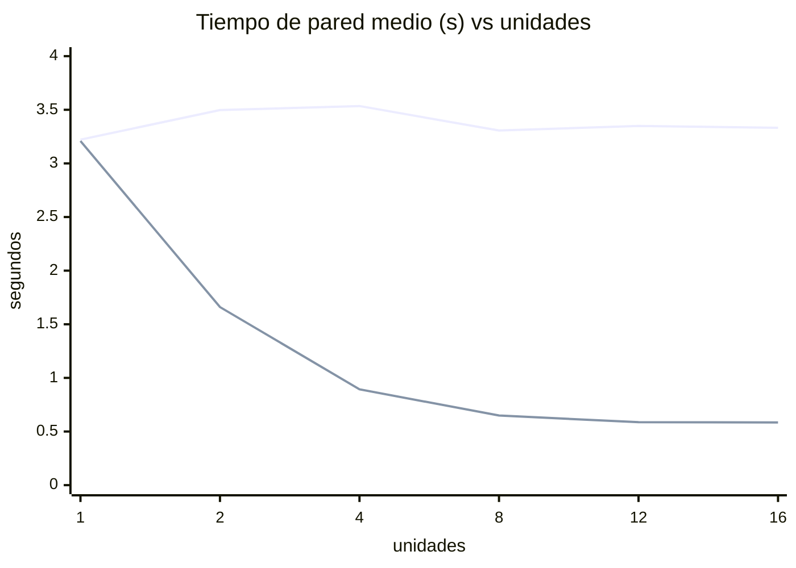

# Laboratorio de Sistemas Operativos: Procesos e Hilos — Versión Python
## Concurrencia, Paralelismo, GIL y Planificación de CPU en Linux

**Informe experimental completo (implementación en Python/CPython)**

---

## 1. Portada y datos del laboratorio

| Dato | Valor |
|---|---|
| Título | Procesos e Hilos en Python: Concurrencia, Paralelismo, GIL y Planificación de CPU |
| Asignatura | Sistemas Operativos |
| Tipo de entrega | Informe experimental reproducible (variante Python) |
| Equipo anfitrión | `nightmare` (CachyOS Linux, kernel 7.2.9-2-cachyos-bore) |
| Arquitectura | x86_64 (AMD Ryzen 5 5500U, Zen 2) |
| Intérprete | CPython **3.14.7** (GCC 16.2.1), GIL **habilitado** (`Py_GIL_DISABLED=0`) |
| Lenguaje | Python 3 (stdlib: `threading`, `os.fork`, `ctypes`, `time`) y scripts de análisis |
| Dependencias | Solo biblioteca estándar (las gráficas se generan como SVG a mano; **no** se usa matplotlib) |
| Fecha de ejecución | 2026-10-15, 17:04–17:09 (America/Bogota, −05:00) |
| Directorio de trabajo | `/home/chaos/Projects/universidad/os/taller` |
| Rama del repositorio | `python` (rama independiente; la versión C vive en la rama `main`) |
| Alcance | **Exclusivamente Linux** |
| Evidencia | Salidas de terminal, archivos CSV y de log (no se dispone de capturas gráficas de escritorio) |

> **Nota metodológica de honestidad.** Todos los valores de este informe fueron **medidos** en el equipo descrito con la implementación Python de `src/`. La carga es **bit a bit idéntica** a la de la versión C (mismos checksums), lo que permite comparar ambas implementaciones con confianza.

---

## 2. Resumen ejecutivo

Se replicó en **Python (CPython 3.14)** el laboratorio de procesos e hilos realizado previamente en C, sobre el **mismo equipo** (1 socket, 6 núcleos físicos, SMT×2 ⇒ 12 procesadores lógicos). Se implementaron versiones **secuencial**, con **hilos** (`threading`) y con **procesos** (`os.fork`), una prueba de **migración** (`sched_getcpu`) y una de **memoria** compartida vs separada.

Como Python es ~**400× más lento por iteración** que C, el trabajo total se fijó en **3 000 000 iteraciones** (secuencial ≈ 3 s), repartidas entre las unidades con `work_for()`, con **3 repeticiones** por configuración (1, 2, 4, 8, 12 y 16 unidades).

Resultados principales **medidos**:

- 1 unidad (secuencial): **3.255 s** de media; utilización ~**99 %**.
- **Hilos (`threading`)**: **no hay aceleración**. De 1 a 16 hilos el tiempo es prácticamente constante (3.22 → 3.33 s) y la utilización ~**100 %**. La causa es el **GIL** (Global Interpreter Lock): solo un hilo ejecuta bytecode Python a la vez.
- **Procesos (`os.fork`)**: aceleración **real**. 2 procesos = **1.661 s** (speedup **1.96**), 4 = **0.893 s** (speedup **3.64**), 8 = **0.649 s** (speedup **5.02**), 16 = **0.584 s** (speedup **5.57**). La curva se satura hacia ~8 unidades.
- **Contraste decisivo 4 hilos vs 4 procesos**: 3.535 s frente a 0.893 s ⇒ **los procesos son ~3.96× más rápidos** para trabajo CPU-bound, precisamente por el GIL. En C ambos empataban (~0.7 s).
- **Afinidad a 1 LP con 4 procesos ⇒ 3.275 s** (igual al secuencial, ~98 % CPU): **concurrencia sin paralelismo**. Con `taskset -c 0,2,4,6` (4 núcleos) ⇒ 0.928 s (~374 %): paralelismo real.
- **Migración observada**: sin afinidad, cada hilo de la prueba de migración visitó hasta **7 CPUs** con hasta **101 migraciones**; fijados con `taskset -c 0`, **1 CPU y 0 migraciones**.
- **Observación del scheduler**: 8 hilos ⇒ un proceso con **9 hilos (NLWP=9)** que consume **~100 %** en total (cada hilo ~10–14 %): huella directa del GIL. 8 procesos ⇒ **8 procesos hijo** a **~99 % cada uno en CPUs distintas**: paralelismo real.
- **Validación cruzada C↔Python**: con el mismo trabajo total, los **checksums coinciden exactamente** entre Python y C (p. ej. `14414186446203882457` para 1 unidad).
- Con **`perf`** (§13.4): todas las configuraciones ejecutan **el mismo número de instrucciones (~1.79×10¹⁰)**; el **IPC es ~2.6–2.8**; en modo usuario los **cambios de contexto y migraciones se reportan como 0** (eventos de kernel restringidos por `perf_event_paranoid=2`).

La **principal limitación** es la misma que en la versión C: el experimento corre en un **escritorio con carga de fondo** (compositor COSMIC, navegador Zen, `mpvpaper`, el agente `opencode`), que ocupa ~**21 % de la CPU (~2.6 de 12 LP)** y explica la varianza y la saturación del speedup.

---

## 3. Introducción y planteamiento del problema

Un programa se convierte en uno o más **procesos**; un proceso puede contener uno o más **hilos**. En un equipo con varios **procesadores lógicos**, el **planificador (scheduler)** decide qué hilo se ejecuta en qué CPU y cuándo. La pregunta central es: *¿cómo se relaciona la estructura del software (procesos/hilos) con la arquitectura física (núcleos, SMT) y con la planificación del sistema operativo, y cómo se refleja en el tiempo de pared y la utilización de CPU?*

Esta variante añade un factor propio de Python que **no existe en C**: el **GIL**. Se estudia la cadena:

`Programa Python → (intérprete con GIL) → Proceso → Hilos → Scheduler → Procesadores lógicos → Núcleos físicos → Ejecución`

El laboratorio exige distinguir con rigor **concurrencia** (varias tareas en progreso, no necesariamente a la vez) de **paralelismo** (varias tareas ejecutándose físicamente al mismo tiempo), **tiempo de pared** (reloj) de **tiempo de CPU** (suma del tiempo que las CPUs dedicaron al proceso), y **proceso** de **hilo** (espacios de memoria e identidades distintos).

En Python aparecen dos matices adicionales:
1. Los **hilos de `threading`** son hilos reales del SO (mapean a `pthreads`), pero el **GIL** impide que ejecuten bytecode Python en paralelo.
2. Los **procesos con `os.fork`** tienen cada uno **su propio intérprete y su propio GIL**, por lo que **sí** logran paralelismo real.

---

## 4. Objetivos

1. Caracterizar el hardware (sockets, núcleos físicos, hilos por núcleo, procesadores lógicos, NUMA).
2. Implementar en Python cargas CPU-bound secuenciales, con hilos y con procesos.
3. Medir tiempo de pared, tiempo de CPU y utilización para 1–16 unidades.
4. **Cuantificar el efecto del GIL** comparando hilos de Python frente a procesos.
5. Analizar el efecto de la afinidad de CPU y demostrar la migración de hilos.
6. Comparar proceso frente a hilo (memoria, comunicación, creación, aislamiento, sincronización).
7. Aplicar medición estadística (promedio, rango, desviación estándar) y calcular speedup y eficiencia.
8. Validar el trabajo frente a la implementación C mediante checksums idénticos.
9. Explicar los resultados en términos de arquitectura, planificación e intérprete.

---

## 5. Marco conceptual

- **CPU física / socket**: la unidad que se inserta en un zócalo. Aquí hay 1 socket (`Socket(s): 1`).
- **Núcleo físico (core)**: unidad de ejecución independiente con sus propias unidades y cachés L1/L2. Aquí hay 6.
- **SMT (Simultaneous Multithreading)**: un núcleo mantiene dos contextos de registro y comparte sus recursos de ejecución. Cada contexto es un **procesador lógico**. Aquí 2 hilos/núcleo ⇒ 12 LP.
- **Procesador lógico (LP)**: lo que el SO planifica individualmente.
- **Proceso**: instancia con su propio espacio de direcciones, descriptores y PID. Se crea con `fork`/`os.fork`.
- **Hilo**: flujo de ejecución dentro de un proceso; comparte el espacio de direcciones con sus pares; tiene su propio TID, pila y contexto. En Python, `threading.Thread` crea un hilo del SO.
- **GIL (Global Interpreter Lock)**: mutex global del intérprete CPython que garantiza que **solo un hilo ejecute bytecode Python a la vez**. Simplifica la gestión de memoria (recuento de referencias) pero **serializa** las cargas CPU-bound escritas en Python puro. No afecta a las llamadas que liberan el GIL (E/S, extensiones como NumPy) ni a **implementaciones independientes**, como los procesos (`os.fork`), que tienen cada uno **su propio GIL**.
- **Concurrencia**: varias tareas progresan en el tiempo; puede darse **en un solo LP** por multiplexación temporal (intercalado).
- **Paralelismo**: varias tareas ejecutan **al mismo tiempo** en LPs distintos. Requiere ≥2 LP disponibles.
- **Tiempo de pared (wall)**: tiempo de reloj transcurrido. **Tiempo de CPU**: suma del tiempo de CPU consumido por **todos** los hilos del proceso (o de los procesos hijo). Si un proceso usa N CPUs a plena carga, `tiempo_cpu ≈ N × tiempo_pared`; de ahí que la **utilización** `= tiempo_cpu / tiempo_pared × 100 %` pueda superar 100 %.
- **Scheduler**: el planificador de Linux (CFS/EEVDF, con balanceo de carga) asigna LPs, aplica **afinidad** (`cpus_allowed`) y puede **migrar** hilos. En CachyOS el kernel es `bore` (variante orientada a interactividad).
- **Speedup** `S(n) = T1/Tn`; **Eficiencia** `E(n) = S(n)/n × 100 %`.

---

## 6. Caracterización del equipo y del entorno

### 6.1 Comandos de identificación

```bash
uname -a
lscpu
lscpu -e
nproc
cat /etc/os-release
python3 --version
python3 -c "import sys, sysconfig; print(sys.version); print('GIL', getattr(sys,'_is_gil_enabled',lambda:'n/a')(), 'Py_GIL_DISABLED', sysconfig.get_config_var('Py_GIL_DISABLED'))"
numactl --hardware
```

### 6.2 Salidas (evidencia textual)

```
$ uname -a
Linux nightmare 7.2.9-2-cachyos-bore #1 SMP PREEMPT_DYNAMIC Fri, 09 Oct 2026 12:11:42 +0000 x86_64 GNU/Linux

$ nproc
12

$ cat /etc/os-release
NAME="CachyOS Linux"
PRETTY_NAME="CachyOS"
ID=cachyos
ID_LIKE=arch
BUILD_ID=rolling

$ python3 --version
Python 3.14.7

$ python3 -c "..."
3.14.7 (main, Aug 14 2026, 06:38:32) [GCC 16.2.1 20260810]
GIL True   Py_GIL_DISABLED 0
```

Extracto de `lscpu`:

```
Architecture:            x86_64
CPU(s):                  12
On-line CPU(s) list:     0-11
Model name:              AMD Ryzen 5 5500U with Radeon Graphics
Thread(s) per core:      2
Core(s) per socket:      6
Socket(s):               1
NUMA node(s):            1
NUMA node0 CPU(s):       0-11
L1d cache:               192 KiB (6 instances)   -> 32 KiB por núcleo
L1i cache:               192 KiB (6 instances)   -> 32 KiB por núcleo
L2 cache:                3 MiB (6 instances)      -> 512 KiB por núcleo
L3 cache:                8 MiB (2 instances)      -> 2 CCX de 4 MiB
CPU max MHz:             2100,0000   (sin incluir boost)
CPU min MHz:             413,6370
```

Topología lógica (`lscpu -e`), donde los LP pares comparten `CORE` y caché L3:

```
CPU NODE SOCKET CORE L1d:L1i:L2:L3 ONLINE    MAXMHZ   MHZ
  0    0      0    0 0:0:0:0          yes 2100,0000 1397,4650
  1    0      0    0 0:0:0:0          yes 2100,0000 1397,4940
  2    0      0    1 1:1:1:0          yes 2100,0000 1397,2500
  3    0      0    1 1:1:1:0          yes 2100,0000 1397,2250
  4    0      0    2 2:2:2:0          yes 2100,0000 1397,4611
  5    0      0    2 2:2:2:0          yes 2100,0000 1397,1770
  6    0      0    3 4:4:4:1          yes 2100,0000 1397,4640
  7    0      0    3 4:4:4:1          yes 2100,0000 1397,3640
  8    0      0    4 5:5:5:1          yes 2100,0000 1397,4871
  9    0      0    4 5:5:5:1          yes 2100,0000 1397,1899
 10    0      0    5 6:6:6:1          yes 2100,0000 1397,4390
 11    0      0    5 6:6:6:1          yes 2100,0000 1397,4260
```

Relevante: los pares de LP que comparten núcleo son **(0,1), (2,3), (4,5), (6,7), (8,9), (10,11)**; los LP 0–5 comparten la instancia L3 `0` y los LP 6–11 la instancia L3 `1` (dos CCX).

`numactl --hardware`:

```
available: 1 nodes (0)
node 0 cpus: 0 1 2 3 4 5 6 7 8 9 10 11
node 0 size: 7245 MB
node 0 free: 2478 MB
node distances:
node     0
  0:  10
```

Estado de energía/frecuencia (relevante para la validez):

```
$ cat /sys/devices/system/cpu/cpu0/cpufreq/scaling_governor
powersave
$ cat /sys/devices/system/cpu/cpufreq/boost
1
$ cat /sys/devices/system/cpu/smt/active
1
```

### 6.3 Tabla de caracterización del equipo

| Dato | Valor medido | Interpretación |
|---|---|---|
| Sockets / CPUs físicas | **1** | Un solo zócalo; un único chip AMD Ryzen 5 5500U. |
| Núcleos por socket | **6** | 6 núcleos físicos (Zen 2), cada uno con L1/L2 propios. |
| Hilos por núcleo | **2** | SMT activo (`smt/active = 1`): 2 contextos por núcleo. |
| Procesadores lógicos | **12** | 6 × 2 = 12 LP online (0–11). |
| Modelo de CPU | **AMD Ryzen 5 5500U with Radeon Graphics** | APU de portátil, familia 23 (Zen 2). |
| NUMA | **1 nodo (node0, CPUs 0–11, 7 245 MB)** | Sin NUMA real: acceso uniforme a memoria (`distance 10`). |
| Cachés | L1 32 KiB×6, L2 512 KiB×6, L3 4 MiB×2 | Dos CCX con 4 MiB de L3 cada uno. |
| Governor / boost | **powersave / boost=1** | Frecuencia dinámica; afecta la reproducibilidad (ver Limitaciones). |
| Intérprete | **CPython 3.14.7, GIL habilitado** | Condiciona el comportamiento de los hilos (ver §5 y §12). |

**Interpretación (6 líneas).** El equipo es un APU de un solo socket con 6 núcleos físicos y SMT de 2 vías, lo que expone **12 LP** al planificador; el paralelismo “duro” máximo es 6. Como solo hay un nodo NUMA, no hay penalización por acceso remoto a memoria. La caché L3 está **particionada en dos CCX de 4 MiB**, relevante solo si la carga usara mucha memoria (la nuestra es casi puramente de registros). El governor `powersave` con `boost` implica frecuencia dinámica, principal fuente de variación. Para Python, el dato clave es que el **GIL está habilitado** (build por defecto, no *free-threaded*), por lo que se anticipa que los hilos **no** paralelizarán y los procesos **sí**.

---

## 7. Diseño experimental y variables controladas

- **Carga CPU-bound determinista.** Bucle `xorshift64` con dependencia encadenada (*loop-carried*) y acumulación de una constante por iteración. El resultado se acumula en un sumidero global para impedir que el intérprete descarte el bucle. **Equivalencia bit a bit con C**: como Python usa enteros de precisión arbitraria, cada operación se enmascara a 64 bits (`MASK = 2⁶⁴−1`) para reproducir el desbordamiento modular de `uint64_t`.
- **Trabajo total fijo.** Todas las configuraciones ejecutan **3 000 000 iteraciones en total**, repartidas con `work_for()` (cociente a todas y `+1` a las primeras `resto`). La suma de iteraciones es **exactamente** el total, sea cual sea el número de unidades.
- **Código común.** Secuencial, hilos y procesos usan la **misma** función `spin_work()` de `work.py`.
- **Variables independientes**: número de unidades (1, 2, 4, 8, 12, 16), mecanismo (hilo/proceso) y afinidad.
- **Variables dependientes**: tiempo de pared, tiempo de CPU, utilización, checksum.
- **Variables controladas**: mismo equipo, mismo intérprete y versión, mismo directorio, mismo trabajo total, 3 repeticiones por configuración.
- **No controladas (amenazas)**: carga de fondo del escritorio, frecuencia dinámica, migración de hilos, estado térmico, presión de memoria.
- **Sincronización y liberación**: en hilos se usa `Thread.join()` y cada hilo escribe en una casilla propia (sin mutex, sin carrera). En procesos se usa una tubería `os.pipe` para comunicar checksums, `os.waitpid` para recolectar y `os._exit()` en los hijos para no duplicar buffers de stdio.

**Validación de trabajo comparable (C ↔ Python).** Con el mismo trabajo total (T = 3 000 000), los checksums de la implementación Python **coinciden exactamente** con los de la implementación C (programa de referencia `spinagg`):

| Unidades | Checksum (Python: hilos y procesos) | Checksum (C, mismo total) | ¿Iguales? |
|---|---|---|---|
| 1 | 14414186446203882457 | 14414186446203882457 | Sí |
| 2 | 572798138279215106 | 572798138279215106 | Sí |
| 4 | 6753946891414406104 | 6753946891414406104 | Sí |
| 8 | 5168058987271470167 | 5168058987271470167 | Sí |
| 12 | 994035908659169943 | 994035908659169943 | Sí |
| 16 | 7950303407621870926 | 7950303407621870926 | Sí |

Esto demuestra que **la carga Python es la misma que la C**, validando la comparación entre ambas implementaciones.

---

## 8. Código fuente y explicación de la implementación

Archivos en `src/` (código completo en el Anexo A):

| Archivo | Descripción |
|---|---|
| `work.py` | Carga común (bit-exacta con C), temporización, reparto de trabajo, `sched_getcpu`, reporte. |
| `secuencial.py` | Versión secuencial (1 unidad). |
| `hilos_threading.py` | Hilos de Python (`threading.Thread` / `join`). |
| `procesos_fork.py` | Procesos Linux (`os.fork` / `os.waitpid` / `os.pipe`). |
| `migracion.py` | Demuestra migración con `sched_getcpu()` y `os.sched_yield()`. |
| `memoria_hilo_proceso.py` | Demuestra memoria compartida vs separada. |

**Núcleo de la carga (`work.py`):**

```python
def spin_work(iters, seed):
    x = (seed | 1) & MASK  # nunca 0: xorshift con estado 0 queda atrapado
    for i in range(iters):
        x = (x ^ ((x << 13) & MASK)) & MASK
        x ^= x >> 7
        x = (x ^ ((x << 17) & MASK)) & MASK
        x = (x + i * WORK_MIX) & MASK   # 0x9E3779B97F4A7C15
    return x
```

**Reparto del trabajo (garantiza total constante):**

```python
def split_work(total, n):
    return total // n, total % n

def work_for(total, n, idx):
    chunk, rem = split_work(total, n)
    return chunk + (1 if idx < rem else 0)
```

**Temporización.** `time.perf_counter()` para el tiempo de pared (equivalente a `CLOCK_MONOTONIC`) y `time.process_time()` para el tiempo de CPU del proceso (suma de todos sus hilos). En la versión de procesos, el tiempo de CPU de los hijos se obtiene con `os.times()` (`children_user + children_system`), equivalente a `getrusage(RUSAGE_CHILDREN)`.

**Acceso a `sched_getcpu`.** La función `os.sched_getcpu` **no está disponible** en esta build de Python; se enlaza `sched_getcpu(3)` de `libc.so.6` mediante `ctypes` (con reserva leyendo el campo `processor` de `/proc/self/stat`).

**El GIL en `hilos_threading.py`.** Los hilos son objetos `Thread`, pero el trabajo se ejecuta en Python puro dentro del bucle de `spin_work`; el GIL asegura que **solo un hilo** está en bytecode Python a la vez. Por eso esta variante es **concurrente pero no paralela**.

**Paralelismo en `procesos_fork.py`.** Cada `os.fork()` crea un **intérprete hijo independiente** (con su propio GIL). El hijo calcula su parte y escribe `{pid, iters, checksum}` por la tubería; el padre acumula y espera.

> **Advertencia de honestidad científica.** La carga es **determinista y medible**, adecuada para comparar configuraciones en *este* equipo, pero **no es un benchmark científico**: mide cómputo de enteros (con fuerte peso del intérprete) y sufre las limitaciones de computación en un escritorio compartido. La lentitud intrínseca de Python obliga a usar un total 267× menor que en C, lo que **relativiza** el costo de creación de hilos/procesos.

---

## 9. Experimento 1: hardware

Ver §6. La tabla de caracterización y las salidas de los comandos constituyen la evidencia. Todos los datos son **medidos**.

- **¿Qué se observa?** 1 socket, 6 núcleos, 2 hilos/núcleo, 12 LP, 1 nodo NUMA.
- **¿Por qué ocurre?** Es una APU Zen 2 con SMT; el firmware expone 12 LP y un único dominio NUMA.
- **¿Qué demuestra?** El paralelismo físico máximo es 6; los 12 LP son contextos lógicos. Esto condiciona el resto del laboratorio.

---

## 10. Experimento 2: proceso frente a hilo

### 10.1 Tiempos medidos (trabajo total 3 M, media de 3 repeticiones)

| Configuración | Tiempo pared (s) | Tiempo CPU (s) | Utilización (%) |
|---|---|---|---|
| Secuencial (1 proceso, 1 hilo) | 3.255 | 3.227 | 99.2 |
| 4 hilos (1 proceso, GIL) | 3.535 | 3.492 | 98.8 |
| 4 procesos (4 espacios) | 0.893 | 3.413 | 382.5 |

### 10.2 Uso de CPU y memoria

- **CPU:** la versión con 4 hilos consume **~99 % de una CPU** (≈1 LP): el GIL los serializa. La de 4 procesos consume **~382 %** (≈3.8 LP): paralelismo real.
- **Memoria (demostrada con `memoria_hilo_proceso.py`):** todos los hilos del mismo proceso comparten el espacio de direcciones; los procesos `fork` tienen espacios separados (copy-on-write).

Evidencia textual de compartición vs separación:

```
=== PROCESOS (os.fork) ===
  [padre] antes del fork: g = 0
  [hijo]  g = 100 (tras escribir 100), pid=...
  [padre] despues del wait: g = 0  -> SEPARADA (cada proceso su memoria)
=== HILOS (threading) ===
  [main]  antes del hilo: g = 0
  [hilo]  g = 100 (tras escribir 100)
  [main]  despues del join: g = 100  -> COMPARTIDA (misma memoria)
```

### 10.3 Diferencias conceptuales observadas

| Aspecto | Hilos (`threading`) | Procesos (`os.fork`) |
|---|---|---|
| Espacio de direcciones | Compartido | Separado (COW) |
| Creación | Más barata (un `pthread` dentro del mismo intérprete) | Más costosa (nuevo intérprete + espacio de direcciones) |
| Comunicación | Directa (variables globales) | Requiere IPC (aquí `os.pipe`) |
| Aislamiento | Bajo (un fallo afecta a todos) | Alto |
| Sincronización | `join` + cuidado con datos compartidos | `waitpid`; el aislamiento evita carreras |
| **Paralelismo en Python** | **No (GIL)** | **Sí (intérprete/GIL por proceso)** |
| Tiempo de pared (4 unidades) | **3.535 s** | **0.893 s** |

- **¿Qué se observa?** Los 4 procesos son **~3.96× más rápidos** que los 4 hilos.
- **¿Por qué ocurre?** El **GIL** obliga a los hilos de Python a turnarse en un único hilo de ejecución del intérprete; los procesos, al tener cada uno su propio GIL, ejecutan en paralelo en varios núcleos.
- **¿Qué demuestra?** En Python, para cargas **CPU-bound puras**, los **procesos superan a los hilos**; en C, en cambio, ambos empatan (los hilos no tenían GIL). El mecanismo del lenguaje, no solo el SO, determina el paralelismo efectivo.

---

## 11. Experimento 3: creación de hilos

`threading.Thread(...).start()` crea un hilo del SO y lo deja **listo** en el planificador; no garantiza que empiece de inmediato ni en un LP concreto. `join()` espera su terminación. En CPython, además, el hilo recién creado debe **adquirir el GIL** para ejecutar bytecode Python: aunque el SO lo tenga programado en una CPU, debe esperar el turno del GIL.

**Por qué crear un hilo no implica ejecutarlo en un núcleo específico.** El SO coloca el hilo en una cola de listos; el planificador escoge, en cada *slice*, qué hilo corre en cada LP. Un hilo puede empezar en un LP, ser **desalojado** y **migrar**. No hay relación fija hilo↔LP salvo que se imponga afinidad (ver §12.4).

**Efecto del GIL en la práctica.** Aunque existan 9 hilos (NLWP=9, §13.1), el proceso consume ~1 CPU: el GIL concede el turno a un solo hilo de bytecode a la vez y, periódicamente (cada `sys.getswitchinterval()`, por defecto **5 ms**), fuerza un cambio de hilo. Esto genera **cambios de contexto de hilo** dentro del proceso, que el SO no ve como cambios de proceso.

---

## 12. Experimento 4: concurrencia y paralelismo (1, 2, 4, 8, 12, 16)

### 12.1 Tabla de tiempos reales — **HILOS** (`threading`, GIL, trabajo total 3 M)

| Ejecución | Hilos | Rep. 1 (s) | Rep. 2 (s) | Rep. 3 (s) | Promedio (s) | CPU total observada | Observación |
|---|---|---|---|---|---|---|---|
| Secuencial | 1 | 3.2333 | 3.2908 | 3.2415 | **3.2552** | 99.2 % (≈1.0 LP) | Baseline |
| A | 2 | 3.4780 | 3.5109 | 3.4780 | **3.4973** | 98.3 % (≈1.0 LP) | **Sin speedup** |
| B | 4 | 3.5175 | 3.5497 | 3.5374 | **3.5349** | 98.8 % (≈1.0 LP) | **Sin speedup** |
| C | 8 | 3.2773 | 3.2918 | 3.3500 | **3.3064** | 100.5 % (≈1.0 LP) | **Sin speedup** |
| — | 12 | 3.3286 | 3.3656 | 3.3523 | **3.3488** | 100.9 % (≈1.0 LP) | **Sin speedup** |
| D | 16 | 3.3106 | 3.3267 | 3.3574 | **3.3315** | 100.9 % (≈1.0 LP) | **Sin speedup** |

El tiempo es **plano** (3.22–3.53 s) y la utilización **~100 %** independientemente del número de hilos: firma del **GIL**. Las pequeñas diferencias (2 y 4 hilos algo más lentos) son sobrecarga de creación/cambio de contexto del GIL.

### 12.2 Tabla de tiempos reales — **PROCESOS** (`os.fork`, trabajo total 3 M)

| Ejecución | Procesos | Rep. 1 (s) | Rep. 2 (s) | Rep. 3 (s) | Promedio (s) | CPU total observada | Observación |
|---|---|---|---|---|---|---|---|
| — | 1 | 3.2088 | 3.2014 | 3.2156 | **3.2086** | 98.9 % | Baseline |
| A | 2 | 1.6515 | 1.6793 | 1.6508 | **1.6605** | 196.9 % | Speedup 1.96 |
| B | 4 | 0.8669 | 0.9556 | 0.8576 | **0.8934** | 382.5 % | Speedup 3.64 |
| C | 8 | 0.6848 | 0.6184 | 0.6441 | **0.6491** | 680.5 % | Speedup 5.02 |
| — | 12 | 0.5730 | 0.5745 | 0.6126 | **0.5867** | 869.3 % | Saturación |
| D | 16 | 0.5588 | 0.5981 | 0.5958 | **0.5842** | 873.1 % | Ganancia marginal |

Aquí **sí** hay aceleración real: el tiempo cae de 3.21 s (1) a 0.58 s (16). La CPU total **sube** de ~3.17 s a ~5.10 s al aumentar el número de procesos: hay **sobrecarga** (creación de intérpretes, fallos de página COW, tubería) que antes no existía en C.

### 12.3 Pruebas de afinidad (4 unidades, trabajo total 3 M)

| Prueba | Afinidad | Rep. 1 (s) | Rep. 2 (s) | Rep. 3 (s) | Media (s) | Utilización media | Interpretación |
|---|---|---|---|---|---|---|---|
| 4 **procesos** en 1 LP | `taskset -c 0` | 3.2741 | 3.2712 | 3.2806 | **3.2753** | 98.4 % | 4 procesos, **1 sola CPU** ⇒ **no hay paralelismo** |
| 4 **procesos** en 4 núcleos | `taskset -c 0,2,4,6` | 0.9313 | 0.9281 | 0.9258 | **0.9284** | 373.8 % | Paralelismo real |
| 4 **hilos** en 1 LP | `taskset -c 0` | 3.3616 | 3.4309 | 3.2682 | **3.3536** | 98.6 % | Igual que sin afinidad (el GIL ya serializa) |

### 12.4 Migración de hilos (evidencia directa)

Salida de `migracion.py` (24 hilos > 12 LP), extracto:

```
INICIO pid=14696 cpu_actual=3 logical_cpus=12 n_workers=24
  worker  0: distinct_cpus=7 migrations=86 lista=0 1 2 3 4 5 7
  worker 13: distinct_cpus=6 migrations=100 lista=0 1 2 3 4 5
  worker 15: distinct_cpus=6 migrations=101 lista=0 1 2 3 4 5
INICIO pid=14731 cpu_actual=0 logical_cpus=12 n_workers=24
  worker  0: distinct_cpus=1 migrations=0 lista=0
  (todos los 24 hilos: distinct_cpus=1, migrations=0)
```

- **¿Qué se observa?** Sin afinidad, un mismo hilo ejecuta en **varios LP** a lo largo de su vida (hasta 7 distintos, ~101 migraciones); con `taskset -c 0`, **siempre en el mismo LP** (0 migraciones).
- **¿Por qué ocurre?** El balanceador de carga y el *wake-up* del scheduler reubican hilos para equilibrar la carga; la afinidad lo impide. El GIL no impide la migración: el SO sigue planificando el hilo y puede moverlo entre cesiones.
- **¿Qué demuestra?** **Un hilo no se ejecuta a la vez en varios núcleos**, pero **sí puede migrar** entre LPs durante su existencia.

### 12.5 Concurrencia vs paralelismo (evidencia)

- **Concurrencia:** `taskset -c 0` con 4 **procesos** ⇒ 3.275 s (como el secuencial) con ~98 % CPU. Los 4 procesos **progresaron** (checksum correcto) pero **se turnaron** en una CPU ⇒ concurrencia sin paralelismo.
- **Paralelismo:** sin afinidad, 4 **procesos** ⇒ 0.893 s con ~382 % de CPU ⇒ ejecución simultánea en ~4 LP. Con 4 **hilos de Python**, en cambio, **no hay paralelismo** ni siquiera sin afinidad (GIL).

---

## 13. Experimento 5: observación del scheduler y utilización de CPU

**Herramientas usadas:** `ps -eLf`, `/proc/<pid>/status`, `pidstat -t -p PID 1`, `pidstat -C python3`, `taskset` y `perf stat`. (`/usr/bin/time` **no está disponible**; se usó `time` del shell y medición interna con `time.perf_counter`.)

### 13.1 Observación (a): 8 hilos de Python (GIL)

```
UID   PID    PPID   LWP   C NLWP TIME CMD
chaos 14873  14870  14873 2    9  00:00 python3 src/hilos_threading.py 8000000 8
chaos 14873  14870  14875 28   9  00:00 python3 src/hilos_threading.py 8000000 8
                     ... (8 hilos de trabajo, NLWP = 9) ...
/proc/14873/status:
  Threads:  9
  Cpus_allowed_list:  0-11
```

`pidstat -t -p 14873 1` (promedio de 5 muestras; se aprecia que el **proceso entero usa ~1 CPU**):

```
TGID    TID    %CPU  CPU
14873     -   100.20   -   python3            <- total del proceso
    -  14875   10.78    4  |__Thread-1
    -  14876   10.98    0  |__Thread-2
    -  14877   14.77    4  |__Thread-3
    -  14883   13.77    2  |__Thread-4
    -  14884   10.98    0  |__Thread-5
    -  14885   13.57    1  |__Thread-6
    -  14886   11.58    2  |__Thread-7
    -  14887   13.77    3  |__Thread-8
```

- **¿Qué se observa?** Existen **9 hilos**, pero el proceso consume **~100 %** (un solo LP); cada hilo suma ~10–14 %.
- **¿Por qué ocurre?** El **GIL**: solo un hilo ejecuta bytecode Python a la vez; los demás esperan el turno. La suma de los hilos ≈ 100 %.
- **¿Qué demuestra?** Hilos reales del SO **no implican paralelismo** en Python puro: evidencia directa del GIL.

### 13.2 Observación (b): 8 procesos (`os.fork`)

```
$ ps -o pid,ppid,pcpu,stat,comm --ppid 15114
    PID    PPID %CPU STAT COMMAND
  15116   15114  102 R<   python3
  15117   15114  102 R<   python3
  15118   15114  101 R<   python3
  15119   15114  102 R<   python3
  15120   15114  101 R<   python3
  15121   15114  102 R<   python3
  15122   15114  101 R<   python3
  15123   15114  101 R<   python3
/proc/15114/status:
  Threads:  1          <- el padre es un solo hilo
```

`pidstat -C python3 1 3` (cada hijo a ~99 % en una CPU distinta):

```
Average:  15116  98.68 %   CPU 10
Average:  15117  98.36 %   CPU  2
Average:  15118  98.36 %   CPU  1
Average:  15119  98.68 %   CPU  7
Average:  15120  98.68 %   CPU  5
Average:  15121  99.01 %   CPU 11
Average:  15122  98.68 %   CPU  6
Average:  15123  97.70 %   CPU  9
```

- **¿Qué se observa?** 8 procesos hijo, cada uno a ~99 % en una CPU distinta (1,2,5,6,7,9,10,11…), es decir **~8 LP en paralelo**.
- **¿Por qué ocurre?** Cada proceso tiene su propio intérprete y su propio GIL: el scheduler los distribuye en núcleos distintos y todos ejecutan a la vez.
- **¿Qué demuestra?** **Paralelismo real** con procesos, frente a la serialización de los hilos.

### 13.3 Carga de fondo (`baseline_carga.py`)

```
Intervalo: 5.0 s   CPU ocupada (todas las LPs) = 21.46 %  ->  ~2.58 de 12 LPs
loadavg: 5.66 5.06 3.41
Top consumidores: opencode (137 %), zen (14.7 %), cosmic-comp (8.1 %), zed-editor, mpvpaper...
```

- **¿Qué se observa?** El escritorio y las herramientas del propio entorno (incluido el agente `opencode`) ocupan ~2.6 LP de 12.
- **¿Qué demuestra?** El paralelismo máximo aprovechable por el proceso es ~9–10 LP, no 12; explica la meseta del speedup en §16.

### 13.4 Contadores de hardware con `perf` (medición añadida)

`perf` (versión 7.2.9-1). Comando:

```bash
perf stat -e cycles,instructions,branches,branch-misses,cache-references,\
cache-misses,context-switches,cpu-migrations,task-clock <programa> <args>
```

**Contadores en modo usuario** (`perf_mediciones.txt`, trabajo total 3 M):

| Configuración | Instrucciones | Cycles | IPC | context-sw | cpu-migr | Fallo pred. (%) | Cache-ref | Fallo caché (%) |
|---|---|---|---|---|---|---|---|---|
| secuencial (1 unidad) | 1.792e+10 | 6.764e+09 | 2.649 | 0 | 0 | 0.3666 | 11 801 951 | 20.8 |
| hilos 1 | 1.790e+10 | 6.759e+09 | 2.648 | 0 | 0 | 0.3853 | 12 896 476 | 19.7 |
| hilos 4 | 1.790e+10 | 6.640e+09 | 2.696 | 0 | 0 | 0.3929 | 15 188 475 | 24.1 |
| hilos 8 | 1.818e+10 | 6.425e+09 | 2.829 | 0 | 0 | 0.1239 | 15 943 084 | 24.4 |
| hilos 12 | 1.801e+10 | 6.439e+09 | 2.796 | 0 | 0 | 0.2480 | 20 548 065 | 19.9 |
| hilos 16 | 1.801e+10 | 6.433e+09 | 2.799 | 0 | 0 | 0.2607 | 18 410 581 | 23.2 |
| procesos 4 | 1.791e+10 | 6.919e+09 | 2.589 | 0 | 0 | 0.3864 | 21 039 650 | 15.7 |
| afinidad proc 1 LP (4 proc) | 1.792e+10 | 6.611e+09 | 2.710 | 0 | 0 | 0.3848 | 15 354 370 | 15.3 |

- **¿Qué se observa?** (1) El **número de instrucciones es idéntico (~1.79×10¹⁰)** en hilos y procesos con el mismo trabajo: prueba a nivel de hardware de que todas las configuraciones hacen **el mismo trabajo** (el GIL no cambia *cuánto* trabajo se hace, solo *cuándo*). (2) El **IPC es ~2.6–2.8**; en Python el intérprete ejecuta un bucle de bytecode con buen paralelismo a nivel de instrucción, a diferencia del C (~2.0). (3) En modo usuario, `context-switches` y `cpu-migrations` se reportan como **0** porque `perf_event_paranoid = 2` restringe los eventos de kernel (para verlos haría falta `sudo`).
- **¿Por qué ocurre?** Python ejecuta ~**460× más instrucciones por iteración** que C (`1.79×10¹⁰ / 3×10⁶ ≈ 5 967` frente a `1.04×10¹⁰ / 8×10⁸ ≈ 13`), lo que explica su lentitud: el costo es **del intérprete**, no de la aritmética.
- **¿Qué demuestra?** El trabajo comparable no es una suposición: está **medido** como instrucciones idénticas entre hilos y procesos. Y la diferencia de rendimiento C↔Python es de **interpretación**, no de cálculo.

**Nota sobre `perf`:** las corridas con `perf stat` tienen **sobrecarga**; por eso **solo se comparan contadores/ratios, no tiempos absolutos**. La evidencia directa de cambios de contexto y migraciones de hilo la aportan `pidstat` (§13.1) y `migracion.py` (§12.4).

---

## 14. Experimento 6: procesos versus hilos

Comparación con **N = 4 unidades** (trabajo total 3 M):

| Característica | Hilos (4) | Procesos (4) |
|---|---|---|
| Memoria | Compartida (mismo espacio) | Separada (COW; cada uno su copia) |
| Comunicación | Directa por variables globales | IPC (`os.pipe`) |
| Creación | Barata (mismo intérprete) | Más costosa (nuevo intérprete + espacio) |
| Aislamiento | Bajo | Alto |
| Sincronización | `join` + cuidado con datos compartidos | `waitpid`; el aislamiento evita carreras |
| **Paralelismo** | **No (GIL, ~99 % CPU ≈ 1 LP)** | **Sí (~382 % CPU)** |
| Observación experimental | **3.535 s** | **0.893 s** |

**Costo de creación medido indirectamente:** con 1 unidad, hilos = 3.2215 s y procesos = 3.2086 s frente a 3.2552 s secuencial. El sobrecosto es pequeño porque la carga (~3 s) domina al costo de creación (milisegundos). La sobrecarga relativa crecería si la carga por unidad fuera corta (por eso `migracion.py` usa lotes pequeños).

- **¿Qué se observa?** Los 4 procesos son **~3.96× más rápidos** que los 4 hilos.
- **¿Por qué ocurre?** El **GIL** serializa los hilos de Python; los procesos tienen GIL independiente y paralelizan de verdad. La compartición de memoria de los hilos no aporta ventaja aquí (no se comparte estado entre unidades).
- **¿Qué demuestra?** En Python puro, para cómputo, **`multiprocessing`/`fork` es preferible a `threading`**. La decisión depende del **GIL**, además de aislamiento, comunicación y costo de creación.

---

## 15. Experimento 7: medición estadística del tiempo

**Fórmulas** (n = 3 repeticiones, `T_i` = tiempo de pared de la repetición i, `T1` = media secuencial = **3.2552 s**):

- Promedio: `T̄ = (1/n) Σ T_i`
- Rango: `R = max(T_i) − min(T_i)`
- Desviación estándar muestral: `s = sqrt( Σ(T_i − T̄)² / (n−1) )`
- Speedup: `S(n) = T1 / T̄(n)`
- Eficiencia: `E(n) = S(n)/n × 100 %`

**Tabla consolidada de estadísticos (datos medidos):**

| Modo | Unidades | n | Media (s) | Mín (s) | Máx (s) | Rango (s) | Desv. est. (s) | CPU media (s) | Util. media (%) | Speedup | Eficiencia (%) |
|---|---|---|---|---|---|---|---|---|---|---|---|
| secuencial | 1 | 3 | 3.2552 | 3.2333 | 3.2908 | 0.0574 | 0.0311 | 3.2274 | 99.15 | 1.000 | 100.0 |
| hilos_threading | 1 | 3 | 3.2215 | 3.1963 | 3.2566 | 0.0602 | 0.0313 | 3.1958 | 99.20 | 1.010 | 101.0 |
| hilos_threading | 2 | 3 | 3.4973 | 3.4780 | 3.5109 | 0.0329 | 0.0172 | 3.4388 | 98.33 | 0.931 | 46.5 |
| hilos_threading | 4 | 3 | 3.5349 | 3.5175 | 3.5497 | 0.0322 | 0.0163 | 3.4918 | 98.78 | 0.921 | 23.0 |
| hilos_threading | 8 | 3 | 3.3064 | 3.2773 | 3.3500 | 0.0727 | 0.0385 | 3.3235 | 100.52 | 0.985 | 12.3 |
| hilos_threading | 12 | 3 | 3.3488 | 3.3286 | 3.3656 | 0.0370 | 0.0187 | 3.3793 | 100.91 | 0.972 | 8.1 |
| hilos_threading | 16 | 3 | 3.3315 | 3.3106 | 3.3574 | 0.0468 | 0.0238 | 3.3604 | 100.86 | 0.977 | 6.1 |
| procesos_fork | 1 | 3 | 3.2086 | 3.2014 | 3.2156 | 0.0142 | 0.0071 | 3.1733 | 98.90 | 1.015 | 101.5 |
| procesos_fork | 2 | 3 | 1.6605 | 1.6508 | 1.6793 | 0.0285 | 0.0162 | 3.2700 | 196.93 | 1.960 | 98.0 |
| procesos_fork | 4 | 3 | 0.8934 | 0.8576 | 0.9556 | 0.0979 | 0.0541 | 3.4133 | 382.45 | 3.644 | 91.1 |
| procesos_fork | 8 | 3 | 0.6491 | 0.6184 | 0.6848 | 0.0664 | 0.0335 | 4.4133 | 680.51 | 5.015 | 62.7 |
| procesos_fork | 12 | 3 | 0.5867 | 0.5730 | 0.6126 | 0.0396 | 0.0224 | 5.0967 | 869.32 | 5.548 | 46.2 |
| procesos_fork | 16 | 3 | 0.5842 | 0.5588 | 0.5981 | 0.0393 | 0.0221 | 5.0967 | 873.06 | 5.572 | 34.8 |
| afinidad_proc_1lp | 4 | 3 | 3.2753 | 3.2712 | 3.2806 | 0.0094 | 0.0048 | 3.2233 | 98.41 | 0.994 | 24.8 |
| afinidad_proc_4core | 4 | 3 | 0.9284 | 0.9258 | 0.9313 | 0.0055 | 0.0028 | 3.4700 | 373.78 | 3.506 | 87.7 |
| afinidad_hilos_1lp | 4 | 3 | 3.3536 | 3.2682 | 3.4309 | 0.1627 | 0.0816 | 3.3060 | 98.58 | 0.971 | 24.3 |

**Fuentes de variación**: (1) **GIL** (reparto del turno de bytecode cada ~5 ms), (2) **scheduler** (migración, balanceo, *jitter*), (3) **procesos del sistema** (escritorio, navegador, `mpvpaper`, el agente `opencode`; ~21 % de CPU), (4) **frecuencia dinámica** (`powersave` + `boost`), (5) **cachés y memoria** (L3 particionada en 2 CCX), (6) **afinidad** y (7) **sobrecarga de creación** (mayor en procesos por el nuevo intérprete).

- **¿Qué se observa?** Los tiempos de los hilos son **planos** y con desviaciones relativamente pequeñas; los de procesos **caen** hasta saturarse. La media de procesos a 12 y 16 es casi igual (0.587 vs 0.584 s).
- **¿Por qué ocurre?** Los hilos no pueden aprovechar núcleos (GIL), así que su tiempo no depende del número de hilos. Los procesos escalan hasta el límite físico (~6 núcleos / ~9–10 LP libres).
- **¿Qué demuestra?** Hay que **reportar la varianza**; y en Python, el **número de hilos es irrelevante** para el rendimiento de cómputo, mientras que el número de procesos **sí** importa.

---

## 16. Resultados consolidados, tablas y gráficas

### 16.1 Gráficas

- Tiempo medio de pared vs número de unidades: `figuras/tiempo_vs_hilos.png` (y `.svg`)
- Utilización media de CPU vs número de unidades: `figuras/cpu_vs_hilos.png`
- Aceleración (speedup) vs número de unidades con recta ideal: `figuras/speedup_vs_hilos.png`

Diagrama Mermaid (alternativa textual a las gráficas):



### 16.2 Tabla consolidada de todos los tiempos (media, s)

| Unidades | 1 | 2 | 4 | 8 | 12 | 16 |
|---|---|---|---|---|---|---|
| Hilos (GIL) | 3.222 | 3.497 | 3.535 | 3.306 | 3.349 | 3.332 |
| Procesos | 3.209 | 1.661 | 0.893 | 0.649 | 0.587 | 0.584 |
| Speedup hilos | 1.01 | 0.93 | 0.92 | 0.99 | 0.97 | 0.98 |
| Speedup procesos | 1.01 | 1.96 | 3.64 | 5.02 | 5.55 | 5.57 |

### 16.3 Observaciones clave de las gráficas

- La curva de **procesos** cae de forma casi hiperbólica de 1→8 unidades (paralelismo efectivo) y **se aplana** desde ~8 (0.65 → 0.59 → 0.58 s).
- La curva de **hilos** es **plana**: no mejora con más hilos (GIL). La recta ideal de speedup (y=x) **solo la sigue** la serie de procesos, y aun así se separa tras 4–8.
- La eficiencia de procesos cae de ~100 % (1–2) a ~63 % (8) y ~35–46 % (12–16), coherente con ~6 núcleos físicos y ~9–10 LP disponibles.

---

## 17. Respuestas a las preguntas 4–13

**P4. ¿Cuántas CPUs físicas, sockets, núcleos físicos y procesadores lógicos tiene el equipo?**
**1 socket**, **6 núcleos físicos**, **2 hilos por núcleo** y **12 procesadores lógicos**. Evidencia: `lscpu` (`Socket(s): 1`, `Core(s) per socket: 6`, `Thread(s) per core: 2`, `CPU(s): 12`) y `lscpu -e`, donde los pares (0,1)…(10,11) comparten `CORE`.

**P5. ¿La cantidad de procesadores lógicos coincide con la cantidad de núcleos? ¿Por qué?**
**No.** Hay 12 LP pero **6 núcleos físicos**. Coinciden solo si `Threads per core = 1`. Aquí el SMT está activo (`smt/active = 1`), así que cada núcleo expone **2 contextos lógicos** (12 = 6×2). Los LP comparten las unidades de ejecución y las cachés L1/L2 del núcleo. (En Python hay *otro* límite adicional: el GIL, que reduce a **1** el paralelismo de los hilos.)

**P6. ¿Qué evidencia permite afirmar que hubo concurrencia?**
La prueba de **afinidad a 1 LP con 4 procesos** (`taskset -c 0`, §12.3): los 4 procesos **progresaron y terminaron con el checksum correcto** (`6753946891414406104`) pero el tiempo fue **3.275 s** (igual al secuencial) y la utilización **~98 %**. Hubo progreso de varias tareas **a la vez en el tiempo** sobre **una sola CPU** ⇒ concurrencia **sin** paralelismo. Además, en la versión de hilos, `ps -eLf` mostró 9 hilos coexistentes aunque el proceso usara ~1 CPU.

**P7. ¿Qué evidencia permite afirmar que hubo paralelismo?**
Con **4 procesos** sin afinidad, el tiempo bajó a **0.893 s** con utilización **~382 %** (más de una CPU: solo es posible si varias CPUs ejecutan a la vez). `pidstat -C python3` mostró **cada proceso hijo ≈99 % en un LP distinto**. En cambio, con **hilos de Python** no se observó paralelismo (GIL): 8 hilos a ~100 % de proceso ⇒ ~1 LP.

**P8. ¿Qué ocurre cuando el número de hilos supera el número de procesadores lógicos?**
En **hilos Python** no cambia nada relevante: 8, 12 o 16 hilos tardan lo mismo (~3.3 s) porque el GIL ya limita a 1 CPU. En **procesos**, se produce **sobre-suscripción** (16 > ~9–10 LP libres): el tiempo de pared apenas mejora (12→16: 0.587→0.584 s) y la eficiencia cae a **~35 %**; además el tiempo de CPU total se mantiene alto (~5.1 s) por sobrecarga y competencia por caché.

**P9. ¿El tiempo de ejecución disminuye linealmente al duplicar los hilos? Explique.**
En **Python, no** (para hilos): el tiempo es **plano** porque el GIL serializa. Para **procesos**, solo hasta ~4 unidades: de 1→2 el tiempo se reduce casi a la mitad (3.209→1.661 s, speedup 1.96, eficiencia 98 %); de 8→16 apenas mejora. La linealidad se rompe por: (a) solo **6 núcleos físicos**; (b) carga de fondo que deja ~9–10 LP; (c) **sobrecarga** de creación de procesos (el tiempo de CPU sube de 3.17 a 5.10 s); (d) el **GIL** en el caso de hilos.

**P10. ¿Puede un hilo migrar entre procesadores lógicos? ¿Cómo podría observarlo?**
**Sí.** Se observó con `migracion.py` + `sched_getcpu()`: con 24 hilos (> 12 LP), hilos como el *worker 0* visitaron **7 CPUs distintas** con hasta **101 migraciones**; con `taskset -c 0` todos quedaron en **CPU 0, 0 migraciones**. La migración ocurre **aunque el GIL impida el paralelismo**: el SO sigue planificando el hilo y puede moverlo.

**P11. ¿Qué diferencia se observó entre ejecutar varios hilos y varios procesos?**
En **memoria/aislamiento**: los hilos comparten el espacio y los procesos tienen espacios separados (el padre no vio el `g=100` del hijo). En **comunicación**: hilos por variables globales, procesos por `os.pipe`. En **desempeño**: **diferencia enorme** (4 hilos 3.535 s vs 4 procesos 0.893 s, **~3.96×**) por el **GIL**. En C esta diferencia no existía: es una consecuencia del lenguaje.

**P12. ¿Qué limitaciones tuvo el experimento?**
(1) **Entorno compartido**: escritorio con compositor COSMIC, navegador Zen, `mpvpaper` y el agente `opencode`, consumiendo ~2.6 LP de 12 (~21 % de CPU), lo que saturó el speedup y añadió varianza. (2) **Frecuencia dinámica** (`powersave` + boost). (3) Solo **3 repeticiones** por configuración. (4) Sin capturas de pantalla del SO. (5) `time.process_time()` en corridas muy cortas puede **subestimar** la utilización. (6) Los eventos de kernel de `perf` requirieron `sudo` y no se midieron en esta variante. (7) La **lentitud del intérprete** obligó a un trabajo total pequeño (3 M), lo que **aumenta el peso relativo** de la creación de hilos/procesos.

**P13. ¿Qué diferencias se encontraron entre sistemas operativos?**
El laboratorio se ejecutó **exclusivamente en Linux**, por lo que no hay comparación entre sistemas operativos: ese aspecto queda **fuera del alcance**. Cabe señalar que la diferencia grande observada (hilos vs procesos) **no es del SO** sino del **intérprete CPython (GIL)**: el mismo sistema operativo (Linux) dio resultados opuestos según se usaran hilos de C (paralelismo real) o hilos de Python (serializados).

---

## 18. Limitaciones, amenazas a la validez y mejoras

1. **Validez interna — carga de fondo:** el escritorio (COSMIC, Zen, `mpvpaper`, `opencode`) consume ~21 % de la CPU (~2.6 LP). **Mejora:** repetir en modo sin GUI, o reservar CPUs con `nice`/`cgroups`.
2. **Validez de constructo — frecuencia dinámica:** governor `powersave` con boost ⇒ frecuencia variable. **Mejora:** fijar `performance` y desactivar turbo (requiere privilegios).
3. **GIL como factor dominante:** los resultados de hilos están dominados por el GIL, no por el hardware. **Mejora:** comparar con una build **free-threaded** (`Py_GIL_DISABLED=1`, Python 3.13+) para aislar el efecto del GIL.
4. **Trabajo total pequeño:** 3 M iteraciones (vs 800 M en C) ⇒ el costo de creación pesa más. **Mejora:** aumentar el total por unidad y medir el arranque por separado.
5. **Instrumentación de hardware parcial:** con `perf` se midieron ciclos, instrucciones, IPC, ramas y caché; los eventos de kernel (`context-switches`) requieren `sudo`. **Mejora:** repetir `perf` con `sudo` y añadir `turbostat`.
6. **Pocas repeticiones:** n = 3 y sin intervalo de confianza. **Mejora:** n ≥ 10, aleatorizar orden, reportar IC al 95 %.
7. **Carga no representativa:** puramente aritmética de enteros, con fuerte peso del intérprete; no evalúa memoria ni extensiones nativas. **Mejora:** añadir una variante con NumPy (que libera el GIL) o memory-bound.

---

## 19. Conclusiones técnicas

1. **El GIL manda en los hilos de Python.** El tiempo con `threading` es **plano** (3.22–3.53 s) y la utilización **~100 %** para cualquier número de hilos: los hilos son **concurrentes, pero no paralelos**. Es la diferencia esencial frente a la versión C, donde los hilos escalaban hasta ~8×.

2. **Los procesos sí paralelizan.** Con `os.fork`, el speedup llegó a **5.57** (16 procesos) y 4 procesos fueron **~3.96× más rápidos** que 4 hilos. En Python, para cómputo CPU-bound, **`multiprocessing`/`fork` supera a `threading`**.

3. **La arquitectura sigue imponiendo el techo.** Aunque cada proceso tiene su GIL, el paralelismo se satura alrededor de **~8 unidades** porque solo hay **6 núcleos físicos** y ~9–10 LP libres. El speedup no puede superar los recursos reales.

4. **Concurrencia ≠ paralelismo.** Con `taskset -c 0` y 4 procesos, el tiempo (3.275 s) iguala al secuencial (~98 % CPU): concurrencia por multiplexación temporal. Sin afinidad, 4 procesos bajan a 0.893 s porque **sí** hay paralelismo.

5. **El scheduler es activo y observable.** Los hilos **migran** (hasta 7 LP, ~101 migraciones) y la afinidad lo controla, **incluso con el GIL**; el SO planifica los hilos aunque solo uno ejecute bytecode a la vez.

6. **La implementación es correcta y comparable.** Los **checksums coinciden exactamente con C** para el mismo trabajo total, lo que valida la carga y permite atribuir las diferencias de rendimiento al **intérprete**, no a la aritmética.

En síntesis: **qué ocurrió** → en Python los hilos no aceleran y los procesos alcanzan ~5.6×; **por qué** → el **GIL** serializa los hilos de Python, mientras que cada proceso tiene su propio intérprete/GIL, todo limitado por 6 núcleos físicos; **cómo se relaciona** → la cadena `programa Python → GIL → proceso/hilo → scheduler → LP → núcleos físicos` explica por qué el paralelismo efectivo depende tanto del **SO** como del **modelo de ejecución del lenguaje**.

---

## 20. Referencias técnicas

1. `lscpu(1)`, `taskset(1)`, `proc(5)` — manuales de util-linux y del kernel Linux.
2. Documentación de CPython: **Global Interpreter Lock** (`threading`, `sys.getswitchinterval`). `https://docs.python.org/3/glossary.html#term-global-interpreter-lock`
3. Documentación de CPython: `os.fork`, `os.pipe`, `os.waitpid`, `os.times`, `time.perf_counter`, `time.process_time`.
4. Python 3.13+ **free-threaded** (`Py_GIL_DISABLED`). `https://docs.python.org/3/whatsnew/3.13.html`
5. Linux `sched(7)` — planificador CFS/EEVDF y afinidad.
6. POSIX Threads Programming (LLNL). `https://hpc-tutorials.llnl.gov/posix/`
7. AMD: arquitectura Zen 2 y Simultaneous Multithreading (documentación del fabricante).
8. `perf(1)` / wiki de `perf` del kernel Linux. `https://perf.wiki.kernel.org/`

---

## 21. Anexos: comandos, salidas y código

### Anexo A. Código fuente

**`src/work.py` (núcleo):**

```python
MASK = (1 << 64) - 1
WORK_MIX = 0x9E3779B97F4A7C15
BASE_SEED = 0x123456789ABCDEF
SEED_STRIDE = 0x100000001B3
DEFAULT_TOTAL = 3000000
g_sink = 0

def spin_work(iters, seed):
    x = (seed | 1) & MASK
    for i in range(iters):
        x = (x ^ ((x << 13) & MASK)) & MASK
        x ^= x >> 7
        x = (x ^ ((x << 17) & MASK)) & MASK
        x = (x + i * WORK_MIX) & MASK
    return x

def now_sec(): return time.perf_counter()
def proc_cpu_sec(): return time.process_time()
def children_cpu_sec():
    t = os.times(); return t.children_user + t.children_system

def split_work(total, n): return total // n, total % n
def work_for(total, n, idx):
    chunk, rem = split_work(total, n)
    return chunk + (1 if idx < rem else 0)

def logical_cpus(): return os.cpu_count() or 1

_libc = ctypes.CDLL("libc.so.6", use_errno=True)
_libc.sched_getcpu.restype = ctypes.c_int
def sched_getcpu(): return _libc.sched_getcpu()
```

**`src/hilos_threading.py` (núcleo):**

```python
def thread_main(iters, seed, out, idx):
    out[idx] = spin_work(iters, seed)   # el GIL serializa estas llamadas

iters_list = [work_for(total, n, i) for i in range(n)]
seeds = [(BASE_SEED + i * SEED_STRIDE) & MASK for i in range(n)]
out = [0] * n
t0_wall = now_sec(); t0_cpu = proc_cpu_sec()
threads = []
for i in range(n):
    t = threading.Thread(target=thread_main, args=(iters_list[i], seeds[i], out, i))
    t.start(); threads.append(t)
for t in threads:
    t.join()
checksum = 0
for v in out: checksum ^= v
```

**`src/procesos_fork.py` (núcleo):**

```python
REC = struct.Struct("<QQQ")   # pid, iters, checksum
r, w = os.pipe()
for i in range(n):
    pid = os.fork()
    if pid == 0:
        os.close(r)
        s = spin_work(work_for(total, n, i),
                      (BASE_SEED + i * SEED_STRIDE) & MASK)
        os.write(w, REC.pack(os.getpid(), work_for(total, n, i), s))
        os.close(w); os._exit(0)      # _exit evita duplicar buffers de stdio
    kids.append(pid)
os.close(w)
# ... leer registros de la tuberia y XOR de checksums ...
for pid in kids: os.waitpid(pid, 0)
```

> El código completo de `secuencial.py`, `migracion.py` y `memoria_hilo_proceso.py` se entrega en `src/`.

### Anexo B. Comandos de ejecución

```bash
# Ejecución individual (desde la raíz del proyecto)
python3 src/secuencial.py 3000000
python3 src/hilos_threading.py 3000000 4
python3 src/procesos_fork.py 3000000 4
taskset -c 0        python3 src/procesos_fork.py 3000000 4   # afinidad a 1 LP
taskset -c 0,2,4,6  python3 src/procesos_fork.py 3000000 4   # afinidad a 4 nucleos
python3 src/migracion.py 2000 300 24                         # evidencia de migracion
python3 src/memoria_hilo_proceso.py                          # memoria compartida vs separada

# Bateria completa + analisis + graficas
./scripts/run_experiments.sh all
./scripts/observar_scheduler.sh
python3 scripts/stats.py
python3 scripts/plots.py

# Contadores de hardware con perf
./scripts/perf_mediciones.sh                 # -> resultados/perf_mediciones.txt
python3 scripts/perf_resumen.py resultados/perf_mediciones.txt resultados/perf_resumen.md
# Contadores de kernel (context-switches, migraciones) requieren sudo:
sudo env OUT=resultados/perf_sudo.txt ./scripts/perf_mediciones.sh

# Validacion rapida de sintaxis
make -C python check
```

### Anexo C. Salidas crudas destacadas

Ejemplo de salida de una corrida de 4 hilos (nótese la utilización ~99 %: GIL):

```
[4 hilos]  RESULT mode=hilos_threading units=4 logical_cpus=12 total_iters=3000000 wall_s=3.517462 cpu_s=3.473984 util_pct=98.76 checksum=6753946891414406104
```

Ejemplo de la versión de procesos (nótese la comunicación por `pipe`, la utilización >100 % y el checksum **idéntico** al de hilos):

```
[fork] hijo pid=... iters=750000 checksum=...
RESULT mode=procesos_fork units=4 logical_cpus=12 total_iters=3000000 wall_s=0.866912 cpu_s=3.370000 util_pct=388.74 checksum=6753946891414406104
```

Ejemplo de `perf stat` (hilos 8):

```
    18.181.xxx.xxx      instructions:u          -> IPC = 2.83
     6.425.xxx.xxx      cycles:u
         x.xxx.xxx      branches:u
                ...     branch-misses:u         (0.12 %)
        15.943.084      cache-references:u
                ...     cache-misses:u          (24.4 %)
```

Archivos de evidencia: `resultados/mediciones.csv`, `resultados/raw_runs.log`, `resultados/estadisticas.csv`, `resultados/estadisticas.md`, `resultados/scheduler_observacion.txt`, `resultados/baseline_carga.txt`, `resultados/perf_mediciones.txt`, `resultados/perf_resumen.md`.
